# HeatWave Audit Center — User manual

**Independent prototype for evaluation and rehearsal. Not an Oracle product; not supported or endorsed by Oracle.**

[HTML edition](../html/index.html) · [PDF edition](../pdf/HeatWave-Audit-Center-User-Manual.pdf)

## Contents

- [1. Background and prototype status](#overview)

- [2. Challenges and the implemented approach](#challenges)

- [3. Deployment architecture](#architecture)

- [4. Network access and security boundaries](#network)

- [5. Data flow, fingerprints and evidence](#data-flow)

- [6. Installation prerequisites](#prerequisites)

- [7. Install and verify the OL9 services](#installation)

- [8. IAM and database access checklist](#iam)

- [9. First working flow: setup order](#first-flow)

- [10. Sign in and password rotation](#login)

- [11. Navigation, tables and notifications](#shell)

- [12. Dashboard](#dashboard)

- [13. Configuration: HeatWave connections](#connections)

- [14. Edit registrations without breaking continuity](#edits)

- [15. Configuration: register a table mapping](#mappings)

- [16. Runtime settings and fingerprint-key setup](#runtime)

- [17. Source validation and full row images](#source-checks)

- [18. OCI resources: common controls](#services)

- [19. OCI Streaming: pools, streams and harnesses](#streaming)

- [20. Queue registrations and topic management](#queues)

- [21. Apache Kafka alternative](#kafka)

- [22. Container Registry and image builds](#registry)

- [23. Container Instances and workload settings](#containers)

- [24. Vault and password references](#vault)

- [25. HeatWave DB resource controls](#heatwave)

- [26. Embedded repository page](#repository)

- [27. Control Center: flow row and status](#control)

- [28. Control Center: action conditions](#control-actions)

- [29. Choose where Debezium begins reading](#capture)

- [30. Apply a reviewed capture position](#capture-apply)

- [31. Message Explorer](#messages)

- [32. Audit Center: all databases overview](#audit-overview)

- [33. Audit Center: table history and lookup](#history)

- [34. Before/after images and operation meanings](#images)

- [35. Charts, intervals and downloads](#charts)

- [36. Schema changes and security auditing](#ddl-dcl)

- [37. Daily operations and a controlled verification](#daily-operations)

- [38. Summary and handover checklist](#summary)

- [Appendix A. Scaling and massive change volume](#scale)

- [Appendix B. Changing configuration safely](#change)

- [Appendix C. Update the application and workloads](#update)

- [Appendix D. One-action eligible payload cleanup](#cleanup)

- [Appendix E. Target data layout and retrieval](#storage)

- [Appendix F. Troubleshooting by observed stage](#troubleshoot)

- [Appendix G. Security, backup and recovery boundaries](#recovery)

- [Appendix H. Glossary and further reading](#reference)

- [Appendix I. DDL-driven row changes and audit coverage](#ddl-data-limitations)

- [Appendix J. HeatWave ETag issue and process errors](#heatwave-etag-errors)

- [Appendix K. Same-compartment resource limitation](#compartment-limits)

<a id="overview"></a>

## 1. Background and prototype status

HeatWave Audit Center is an independent prototype for exploring row-change auditing with OCI MySQL HeatWave. It brings connection setup, table registration, capture controls and audit-history exploration into one web application on an Oracle Linux 9 Compute VM.

**This is a prototype for evaluation, demonstration and rehearsal. It is not an Oracle product and is not supported or endorsed by Oracle.** Oracle service names and architecture symbols describe the integration; they do not imply Oracle authorship, certification or a production guarantee.

The aim is to retain evidence of changes to registered tables: what a row contained before and after an INSERT, UPDATE or DELETE; which source position and queue delivery produced it; and how activity changes over time. The target stores audit history rather than maintaining a current-row replica.

### Audience and scope

Operators use the Dashboard, Control Center, Message Explorer and Audit Center. Application administrators also manage configuration, resources, capture positions and retention. An OCI administrator prepares IAM and networking; a database administrator prepares schemas, users and supported source settings.

This manual describes the repository implementation as reviewed on 24 October 2026, including the lifecycle, diagnostic and coverage clarifications. Screenshots show representative sample records, not a live OCI acceptance test. Endpoint names, resource identifiers and CIDRs are examples. Never copy the example identifiers into a real deployment.

### What is available

- Registered table DML capture, complete row images when the source records them, replay checks, typed-key lookup and operation charts.
- Public schema evidence with available before/after definitions and semantic differences; SQL inspection is used for DDL evidence.
- OCI Container Instances lifecycle and image replacement, same-compartment resource management and explicit partition cleanup.

### Important boundaries

User/privilege auditing needs a separately configured database-audit collector; it is not implemented here. DML binlogs do not establish a complete actor or privilege history. Automatic fleet scaling, shared multi-table source connectors, verified archive export/restore, fingerprint-key rotation and a dedicated schema-comparison browser are not implemented. Validate the chosen deployment, recovery and capacity before relying on it.

**Row-audit coverage:** partition exchange, partition drop/truncate and other DDL can change many rows without individual row-image events, even with ROW/FULL. Schema evidence, fingerprints and event charts cannot establish complete data-change coverage. See Appendix I and [audit limitations](../../limitations.md).

<a id="challenges"></a>

## 2. Challenges and the implemented approach

| Challenge | Approach in this prototype | Operator responsibility |
| --- | --- | --- |
| Incomplete old/new row values | Require ROW/FULL, disable PARTIAL_JSON, validate envelope images | Reconnect source writers after session-related setting changes; old incomplete logs cannot be repaired |
| Binlogs expire during an outage | Require retention above three days; recommend an initial seven-day review point | Size for outage, snapshot and catch-up time; monitor disk and age |
| Repeated delivery after failure | Source-event identity ledger and payload consistency checks | Preserve lineage and checkpoints; investigate conflicting evidence |
| Fast row lookup in growing history | Typed-key HMAC, row-key/time index and monthly partitions | Supply the full key and useful UTC range; preserve its Vault key |
| Container ACTIVE but no data arrives | Separate process/task status from queue and target checks | Verify all stages with a controlled transaction |
| OCI Streaming differs from a Kafka cluster | Kafka-compatible data path, Connect harness state and JDBC private schema history | Prepare both public streams and isolated Connect state |
| Schema changes are more than SQL text | Store available definitions, semantic delta and fidelity | Treat missing default/index/partition metadata as unknown |
| Retention can be undone by replay | Durable expiry cutoff, guarded partition manifest and retained deduplication state | Stop both workloads and review the policy before cleanup |
| Multiple flows grow cost and load | One connector and writer per table flow; bounded target batches | Measure per-source extraction, queue and target capacity; autoscaling is future work |
| Resource deletion affects shared systems | Compartment and installation ownership checks; reject in-use dependencies | Keep IAM and network administration outside the app |

The controls fail closed when coverage, ownership or supported state cannot be established. A denied list operation is not an empty inventory. A failed source check is an instruction to review the source, not permission for the app to change database settings.

<a id="architecture"></a>

## 3. Deployment architecture

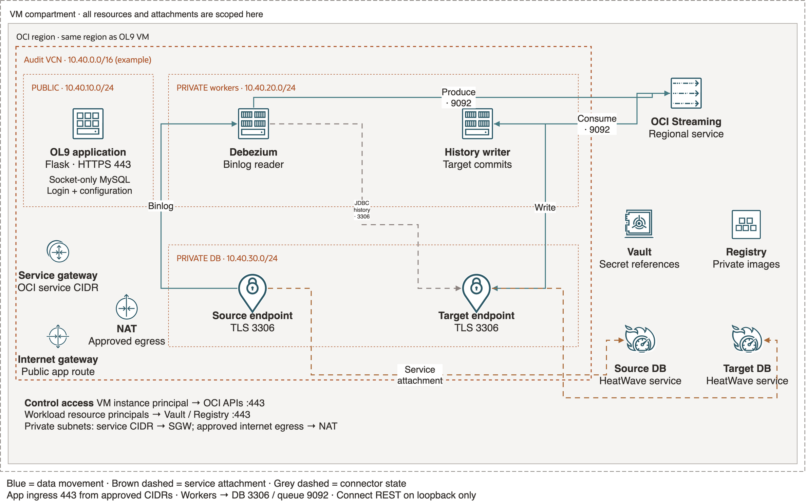

*Reference deployment with example CIDRs. Official OCI symbols are used; generic official compute symbols represent the OCI Container Instances workloads.*

The OL9 VM runs Flask/Gunicorn, HTTPS, a socket-only embedded MySQL control repository and a rootless image-builder service. Embedded MySQL authenticates local accounts and retains registrations, revisions and operations; it is separate from both HeatWave databases.

Debezium and the history writer run as separate OCI Container Instances in a private worker subnet. Debezium connects to the source MySQL endpoint, reads the binlog and publishes row/schema events. The writer consumes those events and commits audit evidence to the target HeatWave schema.

OCI Streaming, Vault and Container Registry are regional services outside customer subnets. HeatWave customer subnet endpoints connect to service-managed DB systems. The region/VCN/subnet boundaries in the diagram are actual draw.io containers, not decorative rectangles.

Resource instances and attachments managed or selected by the application must remain in the VM compartment. IAM groups/policies and shared network provisioning are administrator prerequisites; the app does not modify them. Source/target database connections use the supplied endpoint and a real MySQL login test; the app does not discover a DB system from its IP.

[Editable deployment diagram](../diagrams/deployment-architecture.drawio)

<a id="network"></a>

## 4. Network access and security boundaries

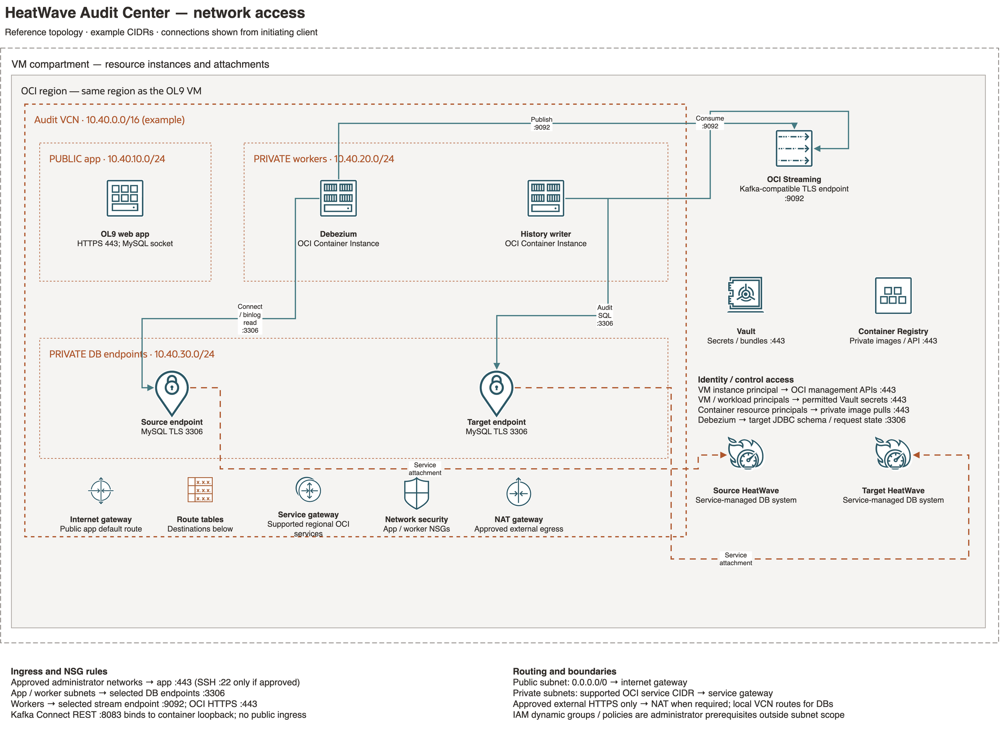

*Example network. Blue arrows show client-initiated data connections; brown dashed links show HeatWave endpoint/service associations. Data can flow back over an established connection.*

| Path | Purpose and restriction |
| --- | --- |
| Approved browser networks → OL9 VM TCP 443 | Web application HTTPS; use the VM DNS name or routable address |
| App / Debezium → source TCP 3306 | Login checks, metadata, binlog reading; TLS policy is global |
| App / writer / Debezium → target TCP 3306 | History browsing, target commits, private JDBC schema history and capture requests |
| Workers → Streaming TCP 9092 | Kafka-compatible TLS producer/consumer connections |
| VM / workloads → OCI TCP 443 | Permitted APIs, Vault secret reads and private registry access |
| Kafka Connect REST TCP 8083 | Container loopback only; do not expose publicly |

Public app-subnet default routing uses an internet gateway. Private subnet routes use the service gateway for supported regional OCI service destinations and approved NAT egress when required. Local VCN routes carry worker-to-DB traffic. Check the selected service endpoint, DNS, NSGs and route tables together; IAM permission does not open a network path.

Private Streaming endpoints, if selected, need their own attachment/DNS/routing review. The reference diagram depicts regional service access, not an assertion that every endpoint is automatically reachable through a service gateway. The app does not create shared gateways, routes or NSG rules.

[Editable network diagram](../diagrams/network-access.drawio)

<a id="data-flow"></a>

## 5. Data flow, fingerprints and evidence

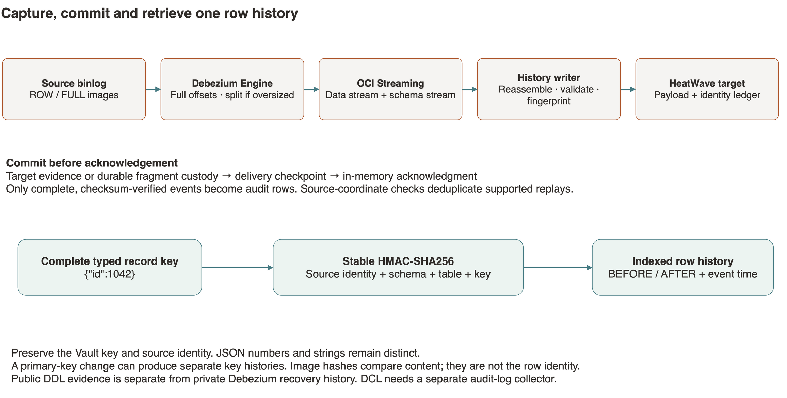

A row change passes through source binlog, Debezium, the data stream and the history writer. Public schema events use a separate single-partition stream. Private Debezium schema recovery history is separate again: for OCI Streaming it resides in the target through JDBC. Connect configuration/offset/status state belongs to the selected harness.

The writer validates each envelope, computes identities, commits fresh payload and ledger evidence, saves durable target delivery checkpoints and then acknowledges queue offsets. These are recoverable stages, not one distributed transaction. A crash can replay messages; supported duplicates are checked against existing evidence.

### Three different identities

- **Row-key fingerprint:** HMAC-SHA256 of canonical typed JSON containing source identity, source schema, source table and complete primary key. It locates versions of that key.
- **Before/after fingerprints:** keyed hashes of row content. They describe content equality/change and are not a replacement for row identity.
- **Event/delivery identity:** source lineage and binlog coordinates identify supported DML replays; queue coordinates identify deliveries and snapshot observations.

Canonical JSON sorts object keys and preserves types. `{"id":1042}` differs from `{"id":"1042"}`. Composite keys must include every key field. Preserve the fingerprint secret and source identity for the lifetime of retained history. A primary-key change can create separate histories; automatic key-alias stitching is not implemented.

[Editable workflow diagram](../diagrams/capture-workflow.drawio)

<a id="prerequisites"></a>

## 6. Installation prerequisites

Deployment is supported on **Oracle Linux 9 only**. Use the non-root application owner with sudo and an architecture-compatible Python 3.12+ environment. The installer uses app-managed MySQL 9.x, Gunicorn/systemd, rootless Podman, Java and Maven dependencies.

### Prepare before installation

1. Choose an OL9 Compute VM and the one compartment that will contain this deployment's resources and network attachments. Confirm region, capacity and service availability.
2. Have the OCI administrator configure the VM instance-principal group, container resource-principal group and compartment-scoped permissions. Prepare VCN/subnets, routes, DNS and NSGs outside the application.
3. Have the DBA prepare source and target schemas/accounts. The source needs replication/full-image settings and a stable table primary key. The target schema needs audit-table/state preparation rights.
4. Create permitted Vault password secrets and identify an existing encryption key for a dedicated fingerprint secret. A database password and fingerprint key serve different purposes.
5. Obtain the official MySQL 9.x Linux generic tarball URL for the VM architecture and its independently verified SHA256.
6. Clone the repository on the VM and create private deployment JSON locally from `examples/deployment.example.json`. Fill real values on the VM; do not publish them or copy another installation's private identity.

Keep the private configuration directory mode 0700 and JSON mode 0600. The selected `compartment_id` and `region` must match the VM. Source endpoint login testing does not verify which OCI DB system owns an IP.

### Preconditions that can block setup

A missing or invalid configuration, non-OL9 OS, wrong interpreter, invalid MySQL checksum, unsupported server major version or insufficient sudo/network access prevents completion. Resolve the cause before rerunning. Setup is rerunnable, but is not a MySQL major-version migration tool.

Reference: [setup and operations](../../operations.md) and [IAM/database access](../../iam-policy.md).

<a id="installation"></a>

## 7. Install and verify the OL9 services

For a fresh VM checkout, clone `https://github.com/ivanxma/hw_data_audit_center.git`, enter that checkout and prepare its private deployment JSON as described in section 6.

Run these examples as the application owner from the checkout. Replace placeholders privately; never place passwords on the command line.

```bash
export AUDIT_CONFIG_FILE=/path/to/private/deployment.json
export AUDIT_MYSQL_TARBALL_URL='https://official-host/path/mysql-9.x-linux.tar.xz'
export AUDIT_MYSQL_TARBALL_SHA256='<verified-sha256>'
./setup.sh
.venv/bin/python scripts/enroll_admin.py
```

Enrollment prompts for an explicit bootstrap password. First login requires changing it and signing in again. Rerunning enrollment does not reset an existing administrator. The manual intentionally provides no reusable bootstrap password.

```bash
.venv/bin/python scripts/check_setup.py
.venv/bin/python scripts/check_setup.py --oci --transport streaming
sudo systemctl status heatwave-audit-local-mysql.service
sudo systemctl status heatwave-audit-https.service
sudo systemctl status heatwave-audit-image-builder.service
```

| Service | What to verify |
| --- | --- |
| heatwave-audit-local-mysql | Local Unix socket available; no public MySQL listener |
| heatwave-audit-https | App running on configured HTTPS port, normally 443 |
| heatwave-audit-image-builder | Builder available before Build & publish |

The installer saves the configuration-file selection and runtime paths in private `.runtime.env`. It generates a self-signed certificate initially; for trusted browser access install a certificate matching the intended DNS name. Custom certificate and key paths must be supplied together.

The HTTPS listener binds to `0.0.0.0`; browse the VM's actual address or DNS name. The app's development HTTP launcher defaults to loopback and is not the deployment entry point. Restrict access with host and OCI rules. Read-only access checks do not prove create permissions or end-to-end capture.

Before a setup rerun, back up the repository/configuration and ensure no image build is active. Do not replace a working embedded MySQL binary as an incidental application update.

<a id="iam"></a>

## 8. IAM and database access checklist

The VM uses its **instance principal** for OCI management. Container Instances use their own **resource principals** for private images, secrets and Streaming data access. The container does not inherit VM permissions. The application does not switch to user API keys when access is denied.

### OCI administrator tasks

Use the full [IAM policy guide](../../iam-policy.md), replacing placeholders with the actual identity-domain/group subjects and VM compartment. Grants depend on enabled features. Typical capabilities include container lifecycle, private repositories, permitted secret metadata/bundles and use of existing network attachments.

`manage stream-family` in the VM compartment covers OCI streams, stream pools and Connect configurations. It does not grant managed Kafka cluster administration. Container principals need permitted produce/consume/read access and secret/repository access separately. A list success proves that read operation only.

App ownership tags guard app actions but are not an IAM isolation boundary. Review dynamic-group membership, especially rules that match every Container Instance in a compartment. The application cannot authorize changes outside its compartment merely because a broader IAM policy exists.

### MySQL account responsibilities

| Account | Required purpose |
| --- | --- |
| Dedicated source connector | SELECT, SHOW DATABASES, REPLICATION SLAVE, REPLICATION CLIENT, LOCK TABLES; RELOAD or supported FLUSH_TABLES alternative |
| Target app/writer | SELECT/INSERT/UPDATE/DELETE plus CREATE/ALTER/INDEX on the chosen audit schema for preparation and maintenance |
| Target Debezium JDBC state | CREATE/SELECT/INSERT/UPDATE/DELETE on its private history and request state; currently reuses the flow's target credential |
| Local administrator | Embedded repository/socket authentication; separate from source and target accounts |

Have the DBA review scoped grants and role activation. The source validation fails closed when it cannot establish required access. Database/schema creation and grants are prerequisites; validation does not apply them. Production account separation and removing preparation rights require a tested migration/runtime design; a separate migrator account is not currently exposed.

Keep safe OCI request IDs for troubleshooting. A 403/404 may indicate membership, policy, wrong resource scope, readiness or regional availability. Retry the same intended principal after correction; do not substitute tenancy-wide grants.

<a id="first-flow"></a>

## 9. First working flow: setup order

Use this sequence after installation. Each stage has a corresponding screen described later.

1. Sign in, rotate the bootstrap password and sign in again.
2. Open Configuration & setup. Test and register source/target connections using Vault references. Optionally create dedicated Debezium/history-writer users in Add connection; the setup administrator is replaced before registration.
3. Open Runtime settings. Generate and configure the dedicated fingerprint secret using a same-compartment vault and existing encryption key.
4. In OCI resources → OCI Streaming, create/select an active stream pool, data stream and a dedicated Connect configuration for the independent connector.
5. In Queue connections, register the pool. OCI Streaming uses principal authentication; no queue username/token is needed.
6. In Table mappings, load source and target objects through connection dropdowns. Choose a new audit table or a compatible existing one. Choose initial **End** for future changes only, or **Start** for a current-row snapshot.
7. Select the mapping, run **Validate source** and resolve every Action required result. Prepare the schema topic `audit_<flow-id>` and verify both public topics are active.
8. In Container Registry, build and publish Debezium and history-writer releases. In OCI Container Instances → Workload settings, select their completed releases, network/shape settings and save both roles.
9. In Control Center select the flow and Deploy. Inspect Debezium process/task state and writer process state; then check actual queue messages and target evidence.
10. On an authorized test table, perform INSERT, UPDATE and DELETE for one known primary key. Confirm the three operations and their correct before/after images in Audit Center.

**Completion means verified evidence, not just an Active badge.** Compare source commit time, queue partition/offset, target event and target checkpoint progress. Keep the same registration identities and fingerprint key when continuity is intended.

The provided [five-minute demonstration](../../../demo/index.html) illustrates these concepts with sample data. It is not proof that a particular deployment meets its operational or recovery requirements.

<a id="login"></a>

## 10. Sign in and password rotation

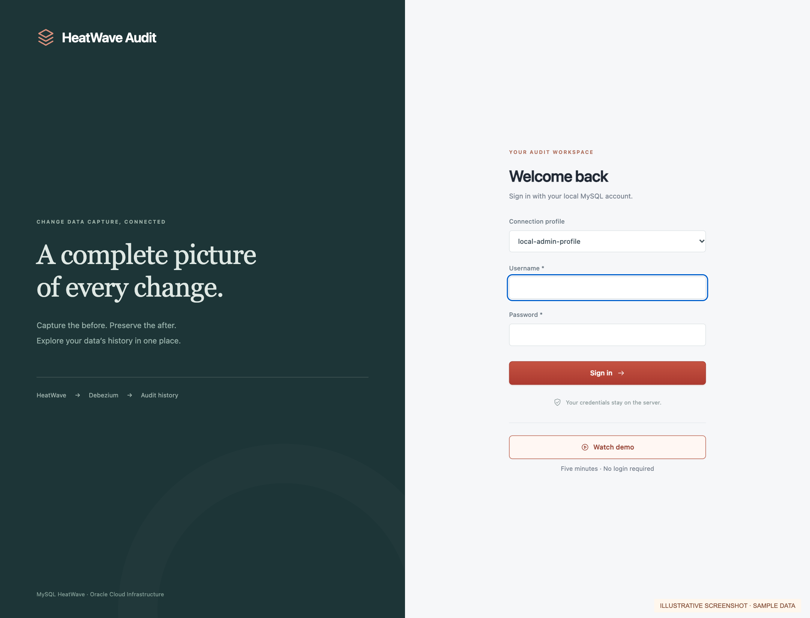

*Sign-in page. Illustrative screenshot using the current templates and isolated sample data.*


| Field / action | Meaning and when to use it |
| --- | --- |
| Connection profile | Select local-admin-profile, the embedded MySQL authentication profile |
| Username | Your local application/MySQL account; initial administrator enrollment creates localadmin |
| Password | Enter privately; it is not prefilled or shown in the browser |
| Sign in | Requires valid credentials and profile; a bootstrap account is redirected to rotation |


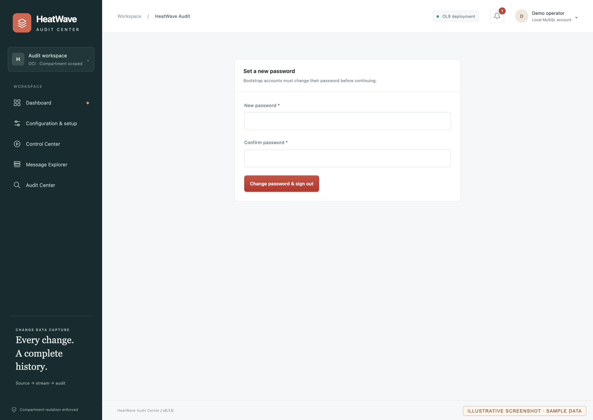

*Password-change page. Illustrative screenshot using the current templates and isolated sample data.*


Enter the same new password in **New password** and **Confirm password**. The UI requires at least 14 characters. **Change password & sign out** rotates the password, clears account sessions and requires a new login. The profile/user menu also provides Change password after login.

The authenticated shell uses server-side session state; the browser receives an opaque session identity. The displayed session expiry is 60 minutes. When the session expires, sign in again before attempting an action. Configuration and lifecycle operations require administrator authorization; a read-only page does not grant mutation rights.

<a id="shell"></a>

## 11. Navigation, tables and notifications

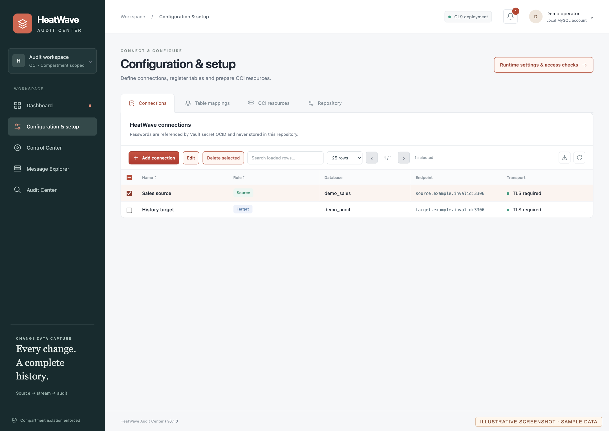

*Single-row selection and the shared table toolbar. Illustrative screenshot using the current templates and isolated sample data.*


The left navigation opens Dashboard, Configuration & setup, Control Center, Message Explorer and Audit Center. Configuration is administrator-only. The top-right account menu shows profile/version, Change password and Sign out.

### Shared table behavior

- Use row checkboxes for selection. **Edit** requires exactly one registration; flow lifecycle actions also require exactly one flow.
- Search filters loaded rows, not the entire database. The page-size selector and arrows page loaded results; Audit Center also has server result pages.
- Click a column heading to sort loaded rows. Drag column boundaries to resize, drag headers to rearrange and use the reset-layout icon to restore the table layout.
- Click a field value, or focus it and press Enter, to open its full value. Close or Escape returns to the table. Links, selection boxes and action controls retain their own behavior.
- The right-side download icon exports loaded/selected table rows as CSV as indicated by the toolbar. A loaded-page export is not a full audit archive.


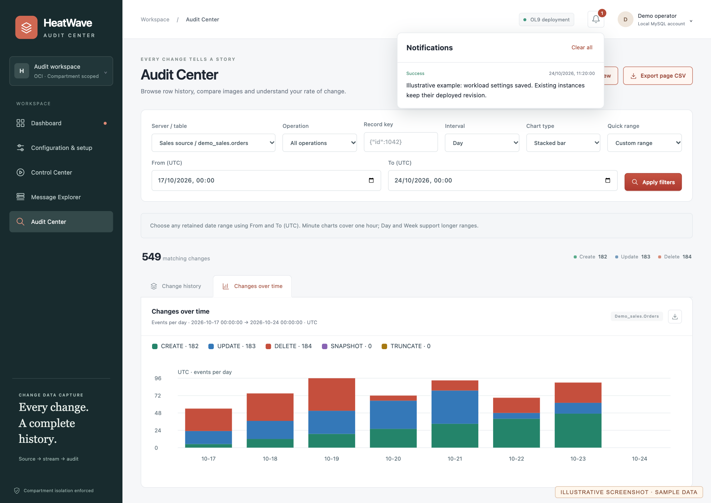

*Top-right notification bell and message history. Illustrative screenshot using the current templates and isolated sample data.*


The bell opens recent messages for the current user/session. **Clear all** clears that list when messages exist. The × on a top message bar dismisses only that bar; the previous message remains available in Notifications. Build completion/failure messages can also appear there. Read the underlying operation status after a timeout; notification clearing does not undo an operation.

Enabled buttons can still be rejected by server-side scope, ownership, state and readiness checks. A grey disabled button needs the required selection/state or permission; use the on-screen guidance to identify which.

<a id="dashboard"></a>

## 12. Dashboard

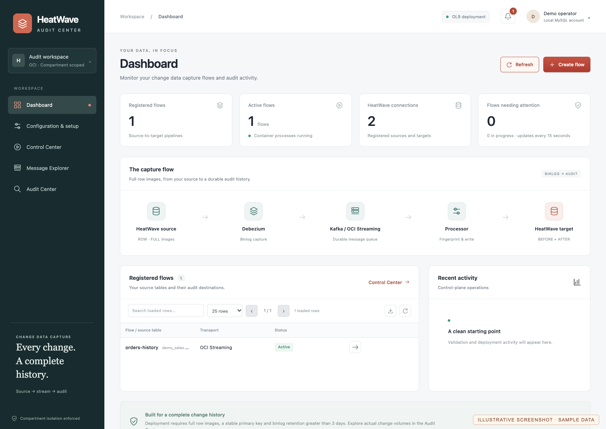

*Dashboard with registered flows and recent control-plane activity. Illustrative screenshot using the current templates and isolated sample data.*


| Area / action | Interpretation |
| --- | --- |
| Registered flows | Number of registered source-table mappings |
| Active flows | Current process/task health summary; it is not a count of successful deliveries |
| HeatWave connections | Registered source and target connection count |
| Flows needing attention | Draft, pending, failed/unavailable or otherwise incomplete flow health |
| Capture flow strip | Conceptual path from source to target; it is not live throughput telemetry |
| Registered flows table | Open history with the right arrow; Control Center opens lifecycle controls |
| Recent activity | Control-plane actions/outcomes and actor/time, not every source SQL statement |
| Refresh | Reload the dashboard; flow health also refreshes periodically |
| Create flow | Administrator shortcut to table registration |

Use this page for a first health overview. If a flow needs attention, open Control Center and inspect both workload tips. A green process state does not establish that data has arrived. Use Message Explorer and Audit Center for evidence, and workload logs/checkpoints for diagnosis.

<a id="connections"></a>

## 13. Configuration: HeatWave connections

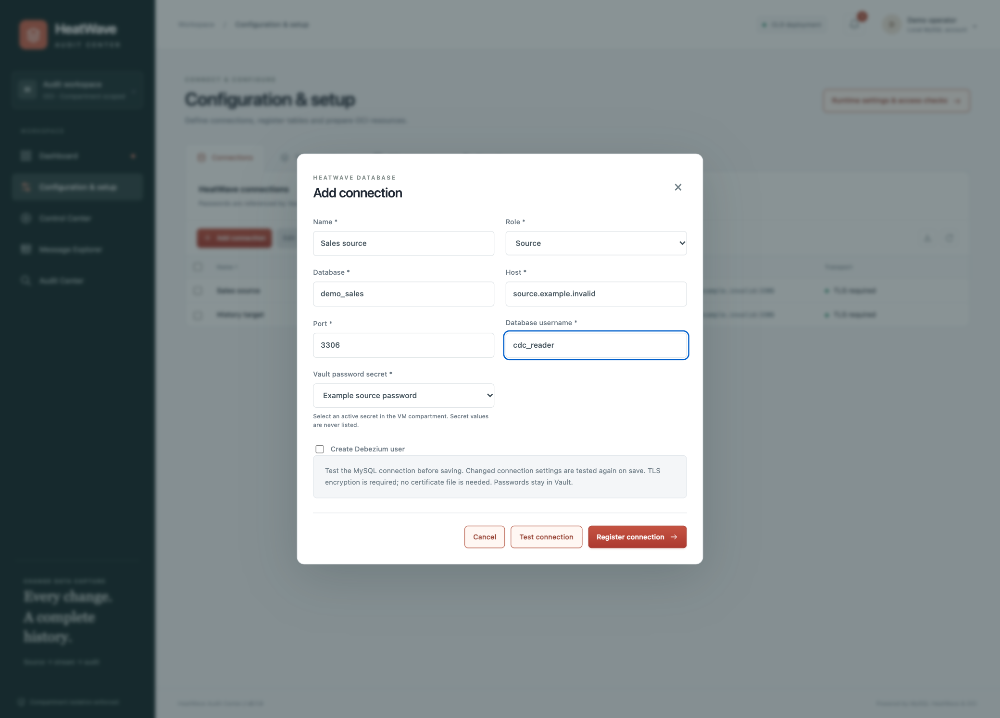

*Add connection dialog. Illustrative screenshot using the current templates and isolated sample data.*


Open **Configuration & setup → Connections → Add connection**.

| Field | Meaning / condition |
| --- | --- |
| Name | Human-readable registration name; up to 100 characters |
| Role | Source for binlog extraction or Target for audit history |
| Database | Accessible database/schema name; DBA creates it beforehand |
| Host | Supplied reachable DB endpoint or IP; no DB system OCID lookup |
| Port | MySQL TCP port; default 3306, valid range 1–65535 |
| Database username | Dedicated source or target account with the required grants |
| Vault password secret | Required dropdown of ACTIVE secrets by name in the VM compartment; select the secret containing this account's password |

**Test connection** requires valid form inputs and performs a real MySQL login using the selected endpoint and Vault reference. A successful test checks connectivity/TLS/login, not binlog readiness; run Validate source later. **Register connection** saves after server validation and connection testing. Changed settings are tested again on save. **Cancel / ×** closes without saving.

MySQL Connector/Python is used. TLS defaults to REQUIRED: encryption is required but a per-connection certificate/CA file is not requested. Optional global verified trust belongs in Runtime settings. The Vault secret is a password reference, not a certificate path.

The list's **Delete selected** removes allowed unused registrations, not the underlying HeatWave DB system. Referenced connections cannot be removed. Use **Edit** with one selected row; deployed/reference restrictions are explained next.

### Create a dedicated Debezium or history writer account

For a new connection, optionally tick **Create Debezium user** (Source) or **Create history writer user** (Target). The original username/secret inputs become temporary setup-administrator inputs. They are used to create the dedicated account, not registered as its runtime credentials.

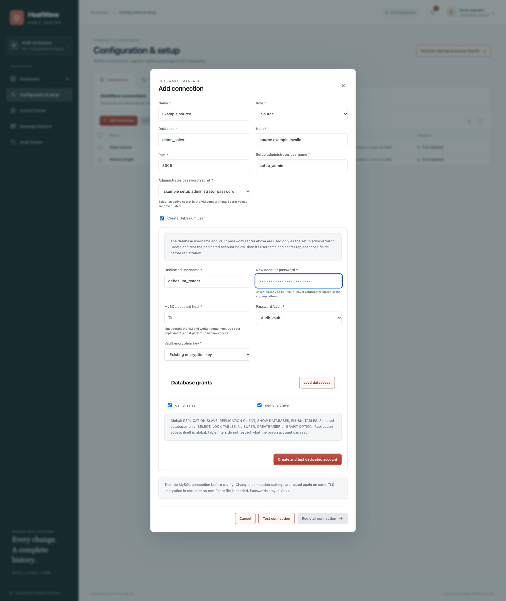

*Illustrative source setup with two selected databases; the entered password remains masked.*

| Field / action | Meaning and condition |
| --- | --- |
| Setup administrator username / secret | Existing administrator and a password secret selected from the same-compartment dropdown, used only during setup; requires CREATE USER and grantable planned privileges |
| Dedicated username | New account, different from the administrator; existing unmanaged users are never reset |
| New account password | 12–256 characters and compliant with the server policy; sent directly to MySQL/Vault, never returned in the response or stored in the app repository |
| MySQL account host | Client-host pattern permitting the VM and worker containers; narrow the default % when appropriate |
| Password Vault / encryption key | ACTIVE Vault and enabled AES key in the VM compartment; new credential secret is created there |
| Load databases | Test administrator access and fetch live database names |
| Database checkboxes | Multi-select the needed databases, including the connection default; up to 50 |
| Allow partition preparation and cleanup | Target only, opt-in ALTER/DROP grants; DROP also permits dropping tables/databases in the selected scope |
| Create and test dedicated account | Store the credential, create the TLS-required user, apply/verify grants, then test its login |
| Register connection | Enabled after successful setup; re-tests and registers the populated dedicated username/secret |

Source grants are global REPLICATION SLAVE, REPLICATION CLIENT, SHOW DATABASES and FLUSH_TABLES, plus SELECT/LOCK TABLES on selected databases. The source receives no SUPER, CREATE USER or GRANT OPTION. Binlog replication access remains global; SELECT scopes and table filters are not a security boundary for the replication feed.

Target grants are SELECT, INSERT, UPDATE, DELETE and CREATE on selected databases. CREATE supports the current audit, checkpoint and JDBC schema-history preparation workflow. Optional partition maintenance adds ALTER and DROP; leave it off when this account does not need those operations. No global/replication/user-management grants are added.

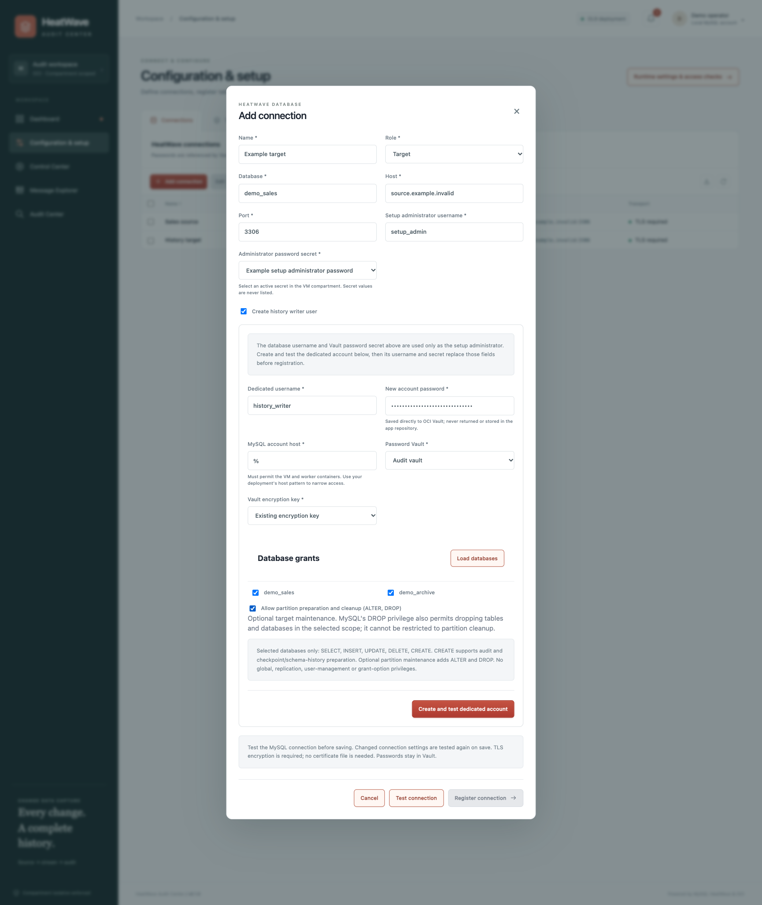

*Illustrative target setup; optional maintenance grants are explicitly selected.*

On success, the dedicated username and new Vault secret OCID replace the administrator inputs and the password field is cleared. Only the dedicated fields are saved and passed to workloads. Existing registered/deployed accounts are unchanged, and creation is not exposed through the restricted Edit dialog.

A partial failure can leave a secret or app-created account because MySQL and Vault do not form a distributed transaction. The safe error identifies the failed step and saved secret reference. Retry unchanged fields to resume the same setup. An existing unmanaged account is never adopted or reset. Non-secret progress is private under .data/account-setups/; it contains no administrator credential reference or password. See [dedicated account setup and limitations](../../dedicated-database-accounts.md) for recovery after reload, database-pattern scope checks and permission details.


The same secret dropdown becomes **Administrator password secret** when dedicated-account creation is enabled. The newly created runtime secret is added and selected automatically after success. Empty/failed secret inventory is shown beside the field; secret values are never returned. See [the compartment restriction](../../compartment-scope.md) and Appendix K for unsupported cross-compartment Vault/resource sharing.


<a id="edits"></a>

## 14. Edit registrations without breaking continuity

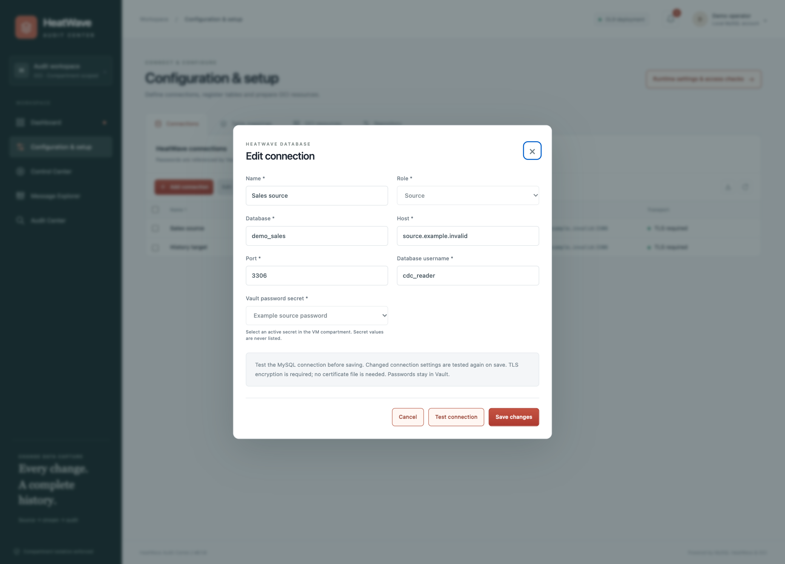

*Prefilled edit dialog with fields locked after deployment history. Illustrative screenshot using the current templates and isolated sample data.*


Select exactly one HeatWave connection, queue connection or table mapping and choose **Edit** in the table toolbar. More than one selection disables Edit. The app loads saved values into the corresponding dialog.

| Registration condition | Allowed changes |
| --- | --- |
| Unused connection | Name, endpoint, role and credentials, subject to a fresh login test |
| Connection referenced only by undeployed drafts | Name and credentials; endpoint/role stay fixed |
| Queue connection referenced by drafts or app-managed topics | Name and supported credentials; selected service/resource stay fixed |
| Undeployed mapping with no deployment history | Available source/target/topic choices and initial capture setting, after validation |
| Entry associated with a deployment attempt/history | Name only; stored capture path, offsets and row identity remain protected |

Stopping a deployed flow does not make its identity disposable. Use a new registration for a different source/target path; use **Capture start** for a supported explicit position change. Renaming preserves flow IDs, connector names, groups, history and fingerprints, and does not restart workloads.

**Save** revalidates permissions and state under server locks. A changed database connection is retested; live mapping/object validation is repeated. If another operator changed the entry after the dialog opened, refresh and reopen it. **Cancel** leaves the saved entry unchanged.

For password rotation on a referenced deployed connection, preserve the secret reference and coordinate rotation of its Vault value and affected workloads. Do not assume a name-only Edit can replace deployed credential references.

<a id="mappings"></a>

## 15. Configuration: register a table mapping

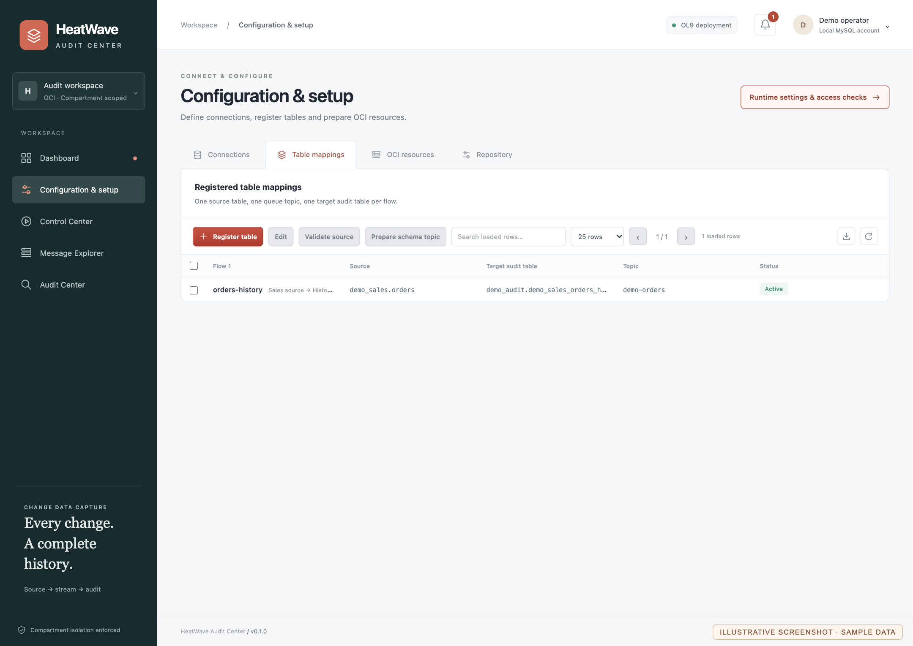

*Registered table mappings. Illustrative screenshot using the current templates and isolated sample data.*


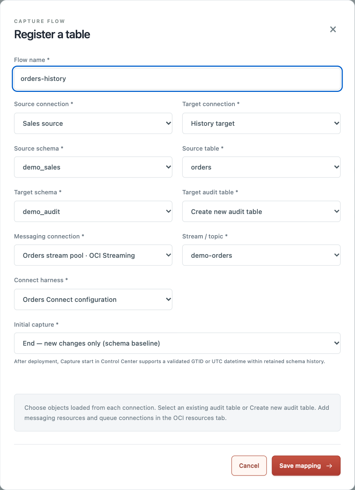

*Source/target object dropdowns and initial capture choice. Illustrative screenshot using the current templates and isolated sample data.*


Open **Table mappings → Register table** after registering source and target connections. Object lists are fetched from the selected database connections; the UI does not require typing table names.

| Field | Meaning / condition |
| --- | --- |
| Flow name | Unique operational label using letters, digits, underscore or hyphen |
| Source connection / Target connection | Select the appropriate registered roles |
| Source schema / Source table | Select a visible source object; needs a stable primary key and approved grants |
| Target schema | Existing writable schema on the target |
| Target audit table | Select a compatible audit table or Create new audit table; a business table is not automatically compatible |
| Messaging connection | Registered OCI Streaming pool or supported managed Kafka connection |
| Stream / topic | Existing data stream/topic in that connection; loaded after connection selection |
| Connect harness | OCI Streaming only; active dedicated Connect configuration for this independent connector |
| Initial capture | Start snapshots current rows; End captures schema then future changes only |

**Save mapping** creates a draft, not running containers. **Cancel / ×** closes the dialog. Register table is unavailable until sufficient source/target registrations exist. Connection/object and queue dropdowns remain disabled while their prerequisites are missing or inaccessible.

Select one mapping and choose **Validate source** to check the live source. **Prepare schema topic** prepares `audit_<flow-id>` with one partition alongside the selected data topic. Wait for readiness before deployment. **Edit** follows the draft/deployed restrictions in section 14.

The app rejects duplicate physical source aliases, incompatible target layouts, source/target feedback paths and reserved recovery-table mappings. Retain one source table, one data topic and one audit payload table per flow in this prototype.

<a id="runtime"></a>

## 16. Runtime settings and fingerprint-key setup

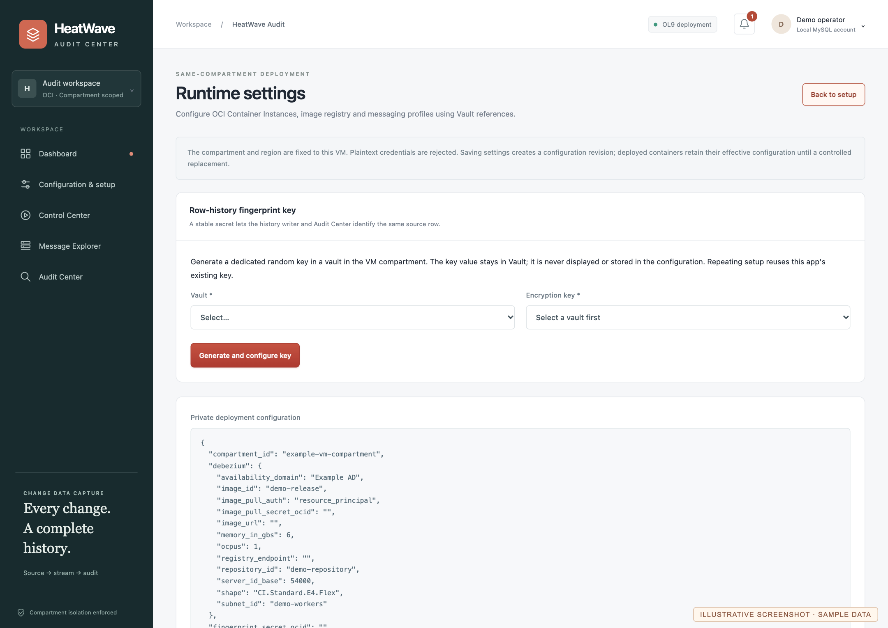

*Runtime settings with dedicated row-history key setup. Illustrative screenshot using the current templates and isolated sample data.*


Open **Configuration & setup → Runtime settings & access checks**. Only administrators can save settings. The compartment and region remain fixed to the VM.

| Field / action | Meaning and condition |
| --- | --- |
| Vault | Existing same-compartment vault for the fingerprint secret |
| Encryption key | Existing supported key in that vault; the app does not create an encryption key |
| Generate and configure key | Create/reuse this app's dedicated random key secret; requires Vault/key permissions |
| fingerprint_secret_ocid | Stable reference used by writers and row-history lookup; independent of database passwords |
| Private deployment configuration | Structured JSON of non-secret settings and Vault/resource references |
| Save configuration revision | Validate JSON/scope and save a recorded revision; never embeds plaintext credentials |
| Run read-only checks | Test service list/read access; success does not certify create/delete, container access or capture |

Once configured, the app prevents removal or replacement of the fingerprint-secret reference. Preserve its value in Vault; key rotation/version routing for existing history is not implemented.

### Settings that operators commonly review

`streaming` selects principal mode, pool, harness and Connect-state profiles. `debezium` and `processor` select workload network, shape, image and secret references. `processor.batch` and offset commit interval bound writer work. `mysql_tls` is global transport policy. `retention` contains explicit per-flow cleanup policies.

Saving a revision does not update effective settings inside existing containers. Select/build the required image and use the matching controlled Update action to replace a workload. Review continuity before changing queue incarnation, source identity, group or target; a configuration edit must not silently reset them.

The configuration contains sensitive deployment references even without passwords. Keep its real file on the VM and out of Git. Examples in this manual are placeholders.

<a id="source-checks"></a>

## 17. Source validation and full row images

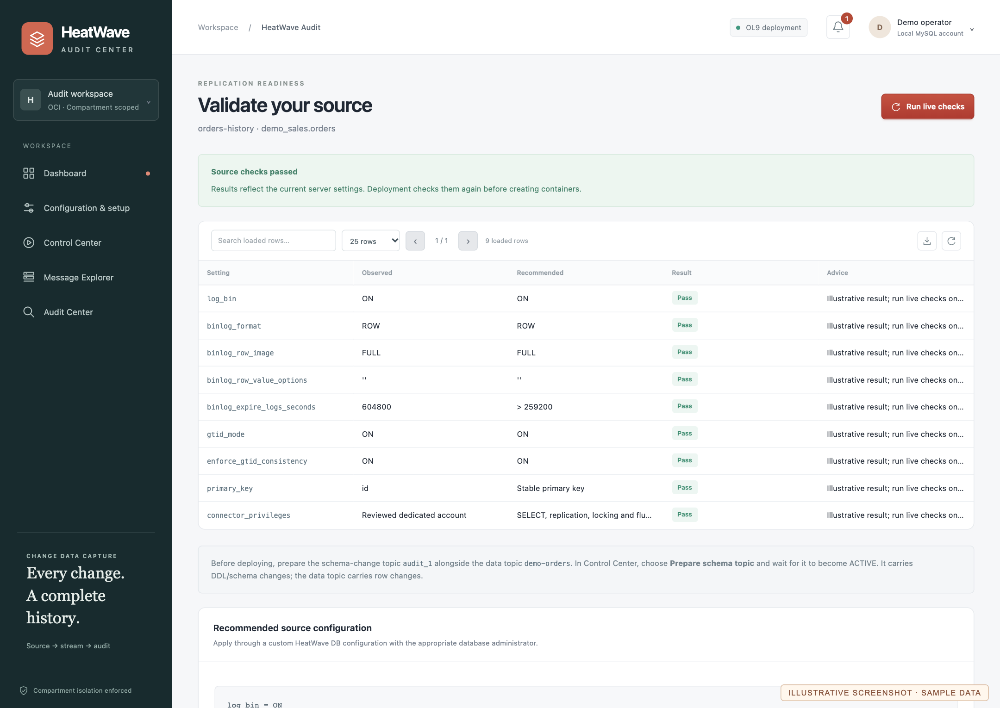

*Live source validation results and recommended settings. Illustrative screenshot using the current templates and isolated sample data.*


Open a selected mapping's **Validate source**, or Control Center → **More actions → Source checks → Run**. **Run live checks** reads the current source variables, table metadata and effective grants. It does not modify the source. Deployment runs readiness checks again.

| Setting | Required / advised behavior |
| --- | --- |
| log_bin | ON |
| binlog_format | ROW |
| binlog_row_image | FULL |
| binlog_row_value_options | Empty; no PARTIAL_JSON |
| binlog_expire_logs_seconds | Greater than 259200 (three days); start sizing review at 604800 (seven days) |
| gtid_mode / enforce_gtid_consistency | ON / ON |
| Primary key | Stable complete row key on each registered table |
| Connector privileges | Dedicated reviewed replication, read, flush and locking access |

**Observed** reports the value read, **Recommended** states the requirement and **Advice** explains a correction. Any Action required result blocks deployment. A failed grant check can reflect role/scope ambiguity; have the DBA review it rather than broadening blindly.

Use supported HeatWave configuration parameters; some changes require a DB restart. Reconnect source application writers after changing session-sensitive row settings, then verify a controlled update. FULL can increase log volume significantly for wide rows/large values. Size source binlog storage, queue messages and target storage accordingly. No setting can reconstruct missing images in old logs.

Prepare the public schema topic before Deploy. It is distinct from the data topic and private recovery history.

<a id="services"></a>

## 18. OCI resources: common controls

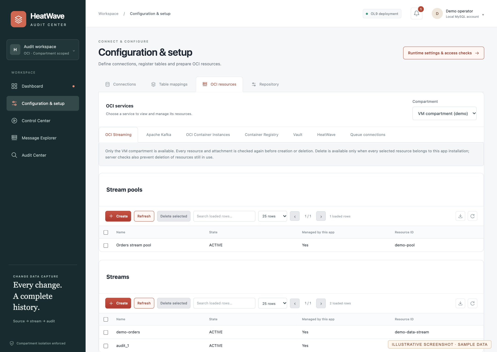

*OCI resources with service tabs, compartment scope and inventory. Illustrative screenshot using the current templates and isolated sample data.*


Open **Configuration & setup → OCI resources**. The service tabs are OCI Streaming, Apache Kafka, OCI Container Instances, Container Registry, Vault, HeatWave and Queue connections. Existing resources with lifecycle state DELETED are filtered from inventories.

| Control / column | Meaning and condition |
| --- | --- |
| Compartment | Contains only the verified VM compartment; submitted changes cannot escape that scope |
| Create | Open the structured service form; requires administrator role, allowed scope and OCI create rights |
| Refresh | Reload the selected service inventory; submitted does not mean ACTIVE |
| Name / State / Resource ID | OCI display name, actual lifecycle state and resource identifier |
| Managed by this app | Whether this installation's provenance permits its lifecycle/deletion controls |
| Delete selected | Enabled only for eligible app-owned selections; backend also rejects in-use resources and rechecks scope/ownership |
| CSV icon | Download the loaded/selected inventory; not a resource backup |

An app can select compatible existing resources without owning them. **Deletion stays disabled for resources not managed by this installation.** Creating with the same name does not transfer ownership. App ownership tags are not a substitute for IAM.

Resource creation is asynchronous and may incur charges. Review the notification/result, refresh and wait for the required lifecycle state. Ambiguous create results must be reconciled against inventory before retrying; do not repeatedly submit to force a duplicate. An authorization error shows the service issue rather than pretending the list is empty.

The app provisions resources and attaches existing networking inside scope; it does not edit IAM policies or shared network rules. OCI service lifecycle actions are separate from removing local connection registrations.

<a id="streaming"></a>

## 19. OCI Streaming: pools, streams and harnesses

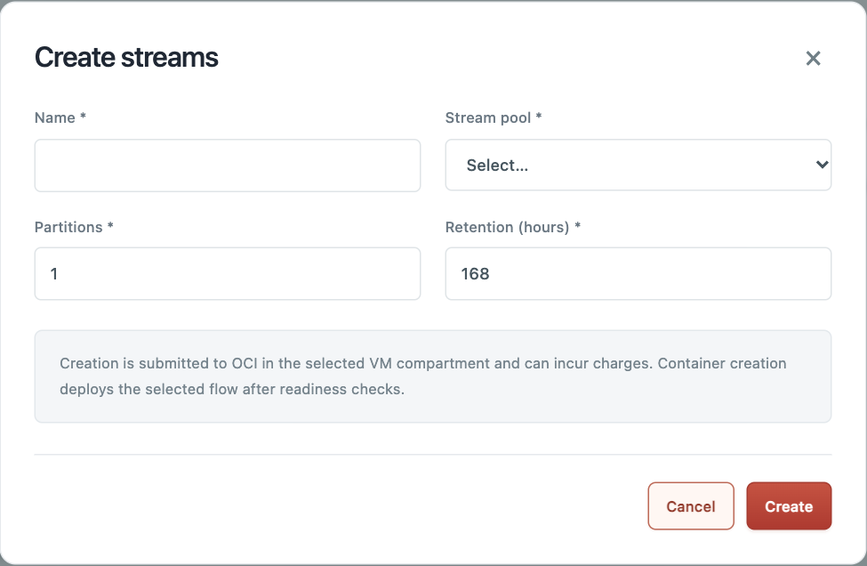

*Create stream dialog. Illustrative screenshot using the current templates and isolated sample data.*


Create/select the pool first. Use a data stream for row envelopes and a separate public schema stream named `audit_<flow-id>`. Each independent connector needs isolated Connect configuration/offset/status state; select a dedicated Connect harness/profile.

| Form | Field | Purpose / condition |
| --- | --- | --- |
| Stream pool | Name | Operational display name |
| Stream pool | Private endpoint subnet (optional) | Existing same-compartment subnet; requires private access/DNS/network review |
| Stream | Name | Unique usable name within the chosen pool |
| Stream | Stream pool | Existing active pool |
| Stream | Partitions | Choose for anticipated load at creation; public schema stream must have one |
| Stream | Retention (hours) | Form allows 24–168; default 168 (seven days) |
| Connect harness | Name | Dedicated Connect configuration for connector state |

**Create** submits the specific resource; **Cancel / ×** abandons the form. **Refresh** observes lifecycle progress. Do not deploy until data, public schema stream and harness are ready and accessible to the relevant principals.

OCI Streaming is accessed through its Kafka-compatible endpoint; this does not require running a separate Kafka cluster. This app uses principal authentication and JDBC private schema history for this transport. Oracle documents differences including unavailable compaction, Kafka transactions, idempotent production and dynamic partition addition; do not assume Kafka configuration examples apply unchanged. See [Streaming compatibility](https://docs.oracle.com/en-us/iaas/Content/Streaming/Tasks/kafkacompatibility.htm).

Public schema history is not the Connect harness state and is not Debezium's private schema recovery store. Keep all three purposes distinct during provisioning and cleanup.

<a id="queues"></a>

## 20. Queue registrations and topic management

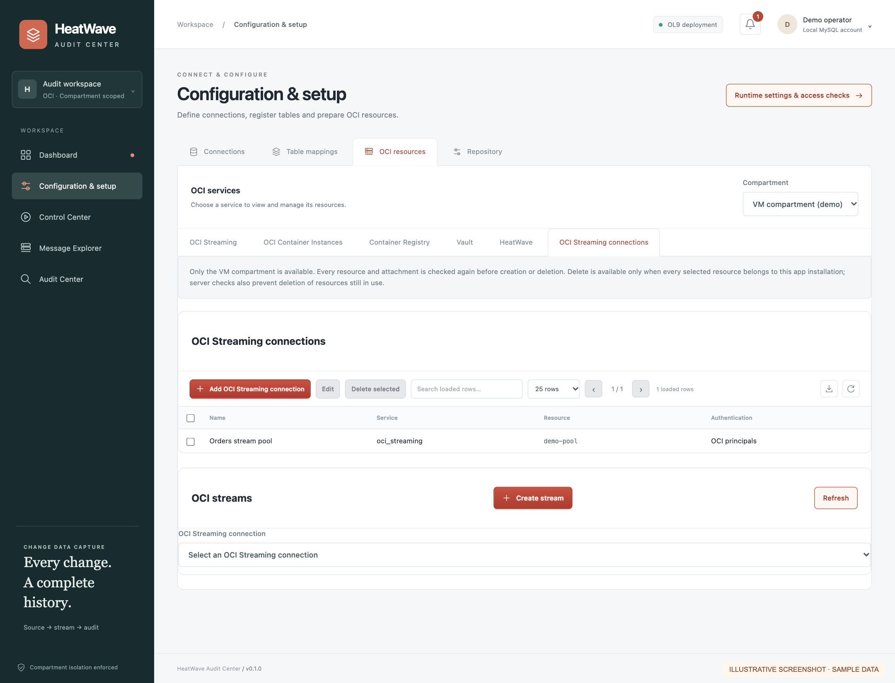

*Queue registrations and topic management. Illustrative screenshot using the current templates and isolated sample data.*


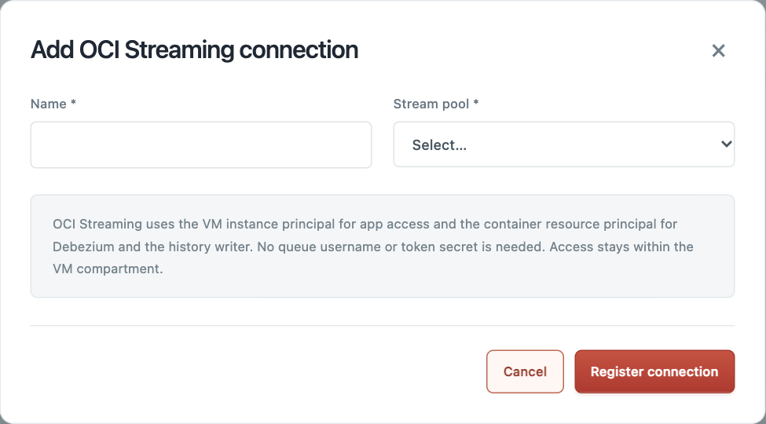

*OCI Streaming queue connection without username or token. Illustrative screenshot using the current templates and isolated sample data.*


Open **OCI resources → Queue connections → Add queue connection**.

| Field / action | Meaning and condition |
| --- | --- |
| Name | Human-readable queue registration |
| Service | OCI Streaming or supported managed Apache Kafka |
| Stream pool / Kafka cluster | Select an existing active same-compartment service resource |
| Kafka/SASL username | Kafka only; hidden and disabled for new OCI Streaming principal-mode connections |
| Kafka password secret | Kafka only; same-compartment Vault credential reference |
| Register queue connection | Verify the selected service and save its registration |

OCI Streaming uses the VM instance principal for app access and container resource principals for Debezium/writer access. No queue username/token secret is required for this mode. Legacy SASL settings are not a reason to add credentials to a new principal-mode registration.

### Streams / Kafka topics panel

Choose **Messaging connection** to load its topics. **Create topic** asks for Messaging connection, Topic name and Partitions. Topic names use letters, digits, dot, underscore or hyphen; the form bounds partitions to 1–1000, while actual service limits can be lower. This action requests seven-day retention and does not silently change an existing topic.

**Refresh** reloads topic state. Use **Prepare schema topic** on the selected mapping for its required single-partition schema stream. Existing matching app-owned topic requests are reconciled; foreign or incompatible topics are not silently adopted. Topic deletion remains guarded by ownership/in-use checks and retention implications.

Select exactly one queue registration for **Edit**. Referenced/app-topic-backed registrations keep their service resource fixed. A queue registration Delete removes the allowed local registration; it does not by itself delete the pool.

<a id="kafka"></a>

## 21. Apache Kafka alternative

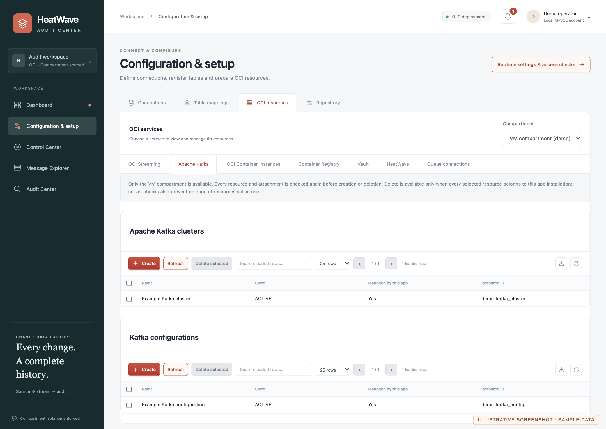

*Managed Apache Kafka cluster and configuration inventories. Illustrative screenshot using the current templates and isolated sample data.*


OCI Streaming is sufficient for the primary workflow. The application also exposes managed Apache Kafka resources; this tab is optional and uses different OCI and broker permissions.

| Form / fields | Purpose |
| --- | --- |
| Kafka configuration: Name, Kafka properties (JSON) | Create the cluster configuration; JSON must be valid |
| Cluster: Name, Kafka configuration, Configuration version | Select the configuration/revision for the cluster |
| Subnet | Existing permitted same-compartment network attachment |
| Supported Kafka version / Coordination type | Supply values supported by the selected regional service/API |
| Cluster type | PRODUCTION or DEVELOPMENT |
| Broker node shape / Broker nodes | Service-supported shape and node count |
| OCPUs per broker / Storage per broker (GB) | Capacity requests within service limits |

These cluster-version/shape fields are typed fields in the current prototype, unlike the HeatWave shape/version dropdowns. Review service-supported values before submission. **Create** is asynchronous; **Refresh** observes completion. Configuration resources may be blocked from deletion while referenced by a cluster.

Register the active cluster in Queue connections with broker username and Vault password secret. The implementation uses SCRAM-SHA-512 over TLS on 9092; mTLS is not implemented. Configure broker/topic ACLs in addition to OCI management IAM. Independent connectors need isolated state topics; Kafka private schema history is different from the OCI Streaming JDBC history path.

An unavailable/denied Kafka inventory does not mean an OCI Streaming flow requires Kafka permissions. Correct the selected service permissions or continue with the intended Streaming configuration; do not change identity or broaden to tenancy-wide access.

<a id="registry"></a>

## 22. Container Registry and image builds

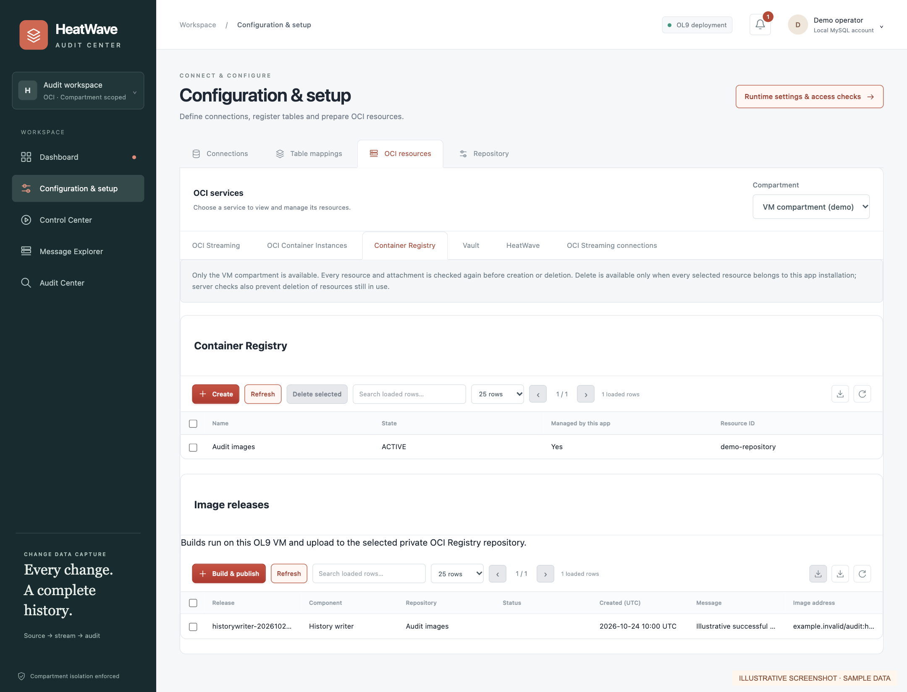

*Container Registry and image release inventory. Illustrative screenshot using the current templates and isolated sample data.*


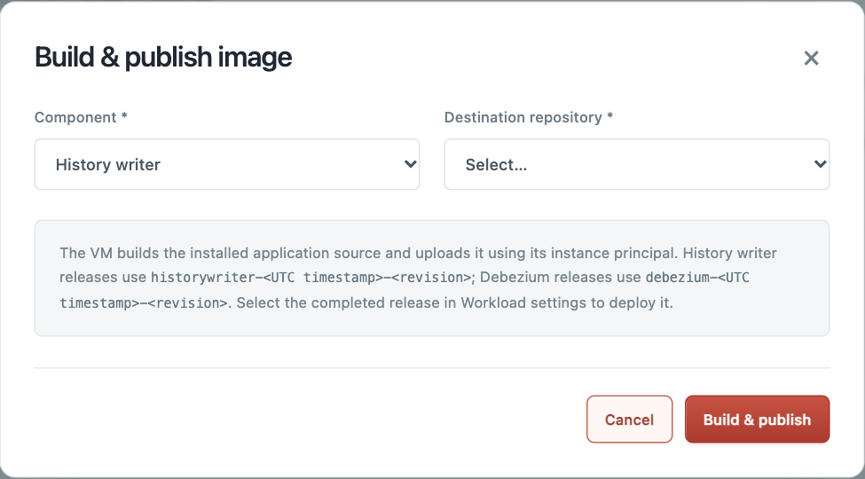

*Build and publish a component image. Illustrative screenshot using the current templates and isolated sample data.*


In **OCI resources → Container Registry**, create/select a private repository. Repository creation asks for **Name**. The app uses the VM instance principal to build and upload images from the installed checkout on the OL9 VM.

| Field / action | Meaning and condition |
| --- | --- |
| Component | History writer or Debezium; build both for a new deployment |
| Destination repository | Same-compartment private OCI Registry repository |
| Build & publish | Submit to the separate image-builder service; requires it to be available |
| Refresh | Reload release/build states and result messages |
| Build log download | Select a build with a log; use the toolbar's log download control |

Releases are named `historywriter-<UTC timestamp>-<revision>` and `debezium-<UTC timestamp>-<revision>`. The image is uploaded during this build/publish operation. Workload settings select the completed release; deployment pins its registry digest internally. You do not type a new digest to initiate a build.

A failed build is not deployable. Review its safe log, dependencies, registry permissions and runtime configuration. A missing `AUDIT_CONFIG_FILE` means the builder/runtime environment needs correction; resubmitting without it will repeat the failure. Do not rerun setup while a build is active.

A newly completed build does not replace running containers. In Control Center select one flow, choose the appropriate **Update image** action, then choose the exact published release in its dialog. Workload settings retain initial-deployment defaults. Resource-principal image pulls need repository permissions for the container principal, independently of successful VM image publication. A static pull secret is optional only when that alternate mode is explicitly selected.

<a id="containers"></a>

## 23. Container Instances and workload settings

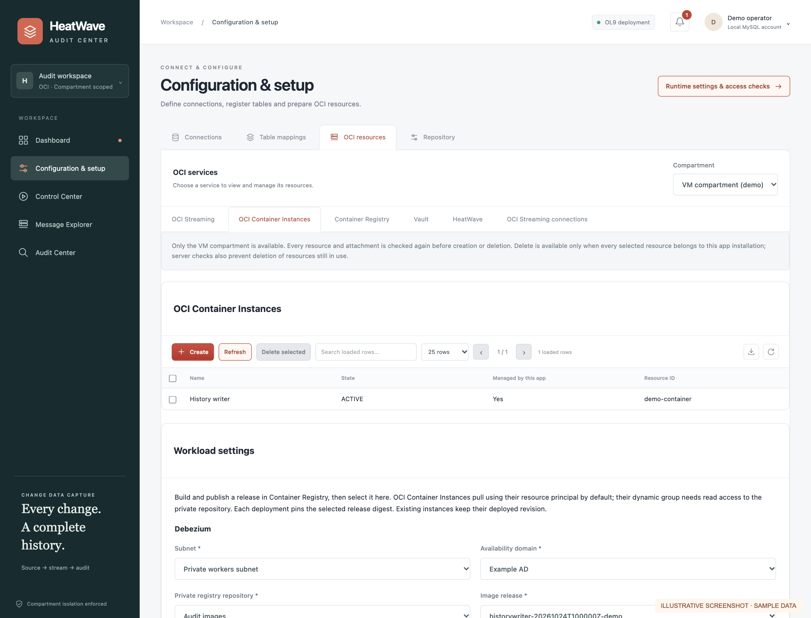

*OCI Container Instances inventory. Illustrative screenshot using the current templates and isolated sample data.*


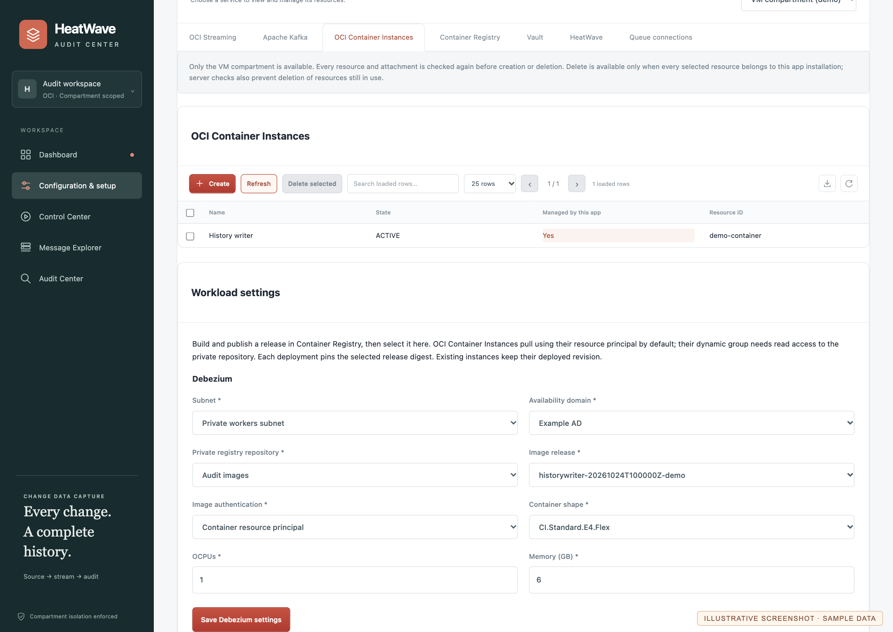

*Workload settings for separate Debezium and history-writer roles. Illustrative screenshot using the current templates and isolated sample data.*


The **OCI Container Instances** tab lists instances and provides a creation form containing **Registered flow**. Creating through that form deploys the selected flow after readiness checks; it is not a generic arbitrary-container editor.

Configure both role forms in **Workload settings**:

| Field | Meaning / condition |
| --- | --- |
| Subnet | Existing private worker subnet in the VM compartment |
| Availability domain | Available placement for the instance |
| Private registry repository | Permitted repository containing the component's image |
| Image release | Completed appropriate component release; digest pinned on deployment |
| Image authentication | Container resource principal by default, or explicit Vault pull secret mode |
| Image pull secret | Required only for Vault mode; hidden/disabled for principal mode |
| Container shape | Available Container Instances shape |
| OCPUs / Memory (GB) | Requested workload capacity within form/service bounds |

**Save Debezium settings / Save History writer settings** records the selection and configuration. Existing containers keep their deployed image and effective revision. **Start** resumes their existing deployment; **Update image** opens a per-flow release picker and performs the controlled replacement. Choosing a release there does not change these defaults or other flows.

Give Debezium sufficient memory for connector/schema state and expected event sizes. Give the writer sufficient memory for bounded batches and target connections. Shape changes do not create automatic scaling; review replacement behavior and capacity with an acceptance test. The current lifecycle model tracks one connector and one writer per flow.

Use flow controls for app-owned workloads. Resource inventory deletion and retired-container termination are guarded and should not be used as an offset-reset mechanism.

<a id="vault"></a>

## 24. Vault and password references


*Vault and secret inventories. Illustrative screenshot using the current templates and isolated sample data.*


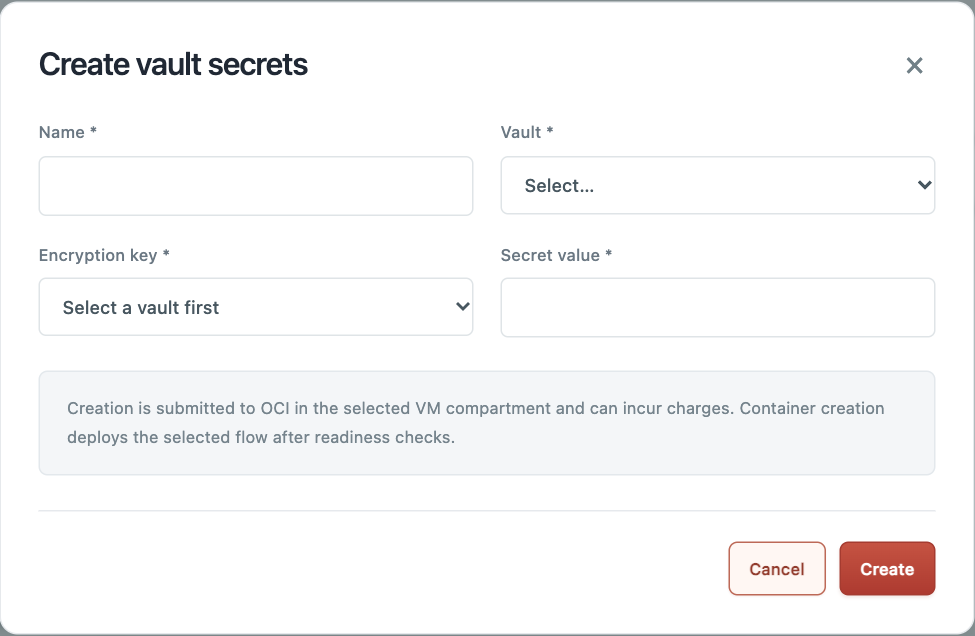

*Create a secret using an existing vault and encryption key. Illustrative screenshot using the current templates and isolated sample data.*


Use the **Vault** tab to list vaults and secrets. New vault creation asks for **Name**. Secret creation asks for:

| Field | Purpose |
| --- | --- |
| Name | Display name describing the secret purpose |
| Vault | Existing permitted vault in the VM compartment |
| Encryption key | Existing supported key belonging to that vault |
| Secret value | Enter privately; used to create the secret, not stored as a connection password |

**Create** submits the chosen resource; **Cancel / ×** discards the form. **Refresh** checks readiness. Selecting the resource later uses its identifier, not its plaintext value. Secret creation needs Vault/key encryption rights; reading existing secret metadata and retrieving secret bundles are different permissions.

Use separate purpose-specific secrets: source DB password, target DB password and the dedicated row-history fingerprint key. Kafka credentials or an optional registry pull secret are additional only for their configured modes. The key-generation screen creates the fingerprint secret; it should not contain a database password.

Delete controls are app-ownership/in-use guarded. Vault/secret deletion is scheduled according to the OCI operation; it is not always immediate. Do not schedule deletion of the fingerprint secret or a credential needed by retained history/recovery. Review actual OCI state after submission.

Workloads resolve permitted secrets through their own resource principals. Successful VM Test connection does not prove that a container can read the same secret. Secret rotation and effective workload refresh need an explicit controlled procedure.

<a id="heatwave"></a>

## 25. HeatWave DB resource controls

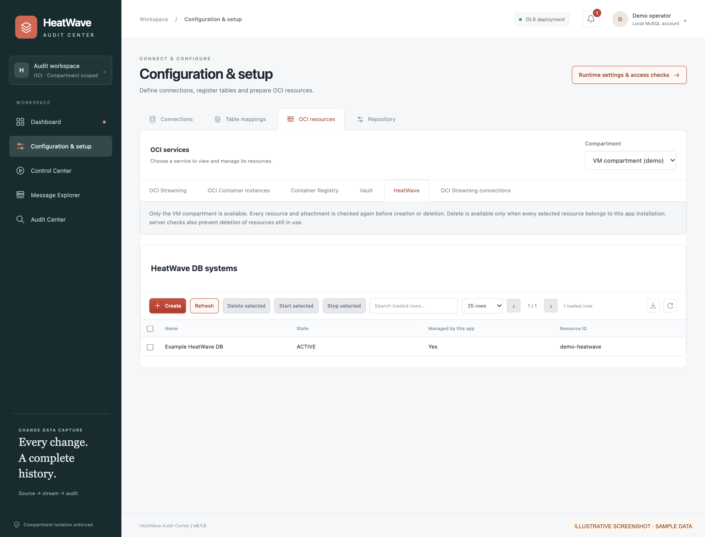

*HeatWave DB system inventory. Illustrative screenshot using the current templates and isolated sample data.*


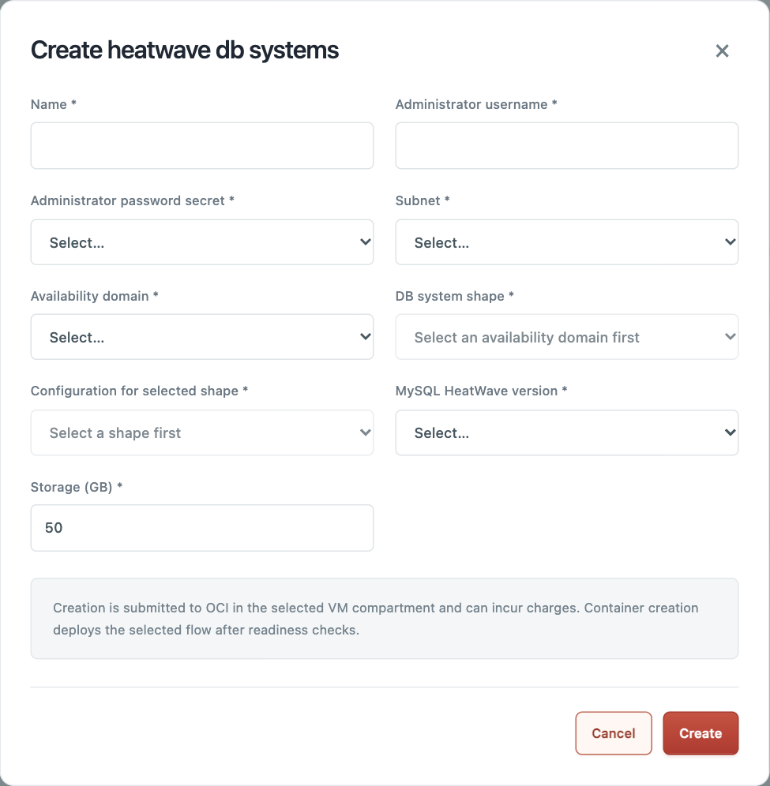

*HeatWave creation with dependent shape, configuration and version dropdowns. Illustrative screenshot using the current templates and isolated sample data.*


The **HeatWave** resource tab manages DB systems independently of the Connections registrations. A connection can use an existing supplied endpoint without entering its DB system OCID.

| Create field | Meaning / condition |
| --- | --- |
| Name | DB system display name |
| Administrator username | Initial DB administrator account |
| Administrator password secret | Vault reference for the account password |
| Subnet / Availability domain | Existing permitted attachment and placement |
| DB system shape | Loaded available shapes after placement selection |
| Configuration for selected shape | Compatible shape-matched default/custom configuration |
| MySQL HeatWave version | Loaded available service versions |
| Storage (GB) | Requested supported storage size; form minimum 50 GB |

**Create** submits the DB system and may incur charges; it does not automatically register a table flow. Wait for readiness, confirm endpoint/schema/accounts, then add the appropriate connection. An Oracle-owned default configuration is a service-catalogue choice; selected custom resources and attachments must satisfy the app's scope checks.

Select 1–25 distinct same-compartment DB systems. **Start selected** requires every selected DB system to be INACTIVE; **Stop selected** requires every selected system to be ACTIVE. These actions do not require app ownership, whereas deletion does. Stopping interrupts database connections and capture/writes. Operations can be asynchronous and conditional. HTTP 412 can reflect a lifecycle/precondition conflict; refresh state and review the request details instead of repeating blindly.

**Delete selected** is disabled for resources not managed by this installation and rejected when referenced/in use. Deleting a DB system is separate from deleting a connection or flow registration and can destroy data. Preserve needed audit evidence and recovery state before any resource cleanup.

### HeatWave operations omit ETag / If-Match

The app does not send ETag/If-Match for HeatWave OCI operations. Fresh compartment/state checks, deletion ownership/dependency checks and request IDs remain. Start/Stop uses an idempotency token. HTTP 412 was observed even after refreshing GET responses; compression could alter a representation ETag, and resource-version mismatches also occurred without it. The app does not modify an opaque ETag or rely on a refresh to solve every failure. See Appendix J.

<a id="repository"></a>

## 26. Embedded repository page

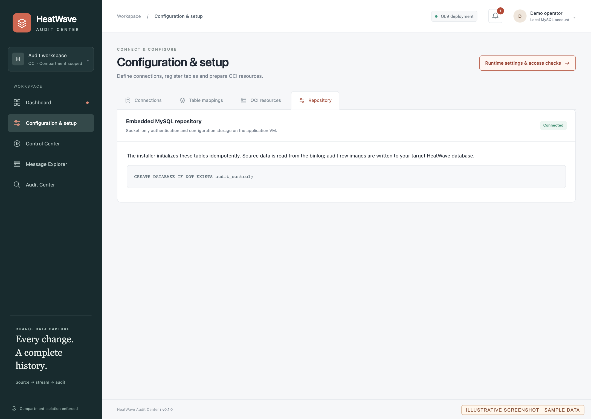

*Embedded MySQL repository information. Illustrative screenshot using the current templates and isolated sample data.*


Open **Configuration & setup → Repository** to view the local control-repository information and initialization SQL. The installer initializes the repository tables idempotently.

The local socket-only MySQL stores application accounts, connection references, table mappings, configuration revisions, operation records, resource provenance and build registrations. It is not the source binlog database and not the target audit payload store.

The **Connected** badge describes the local repository context; it does not prove source or target connectivity. Source data is read through Debezium from the registered source; row images are written to the selected target HeatWave schema.

There is no arbitrary SQL execution or full database-backup action on this information page. Use approved database backup tooling for consistent local-repository backups, together with the private runtime configuration and app installation identity. Restoring only the application source without its private identities/state does not establish capture continuity.

Do not copy local repository files, `.runtime.env`, sessions, TLS keys or an app-instance identity into a new independent deployment. Refer to the backup/recovery appendix when recovering the same installation.

<a id="control"></a>

## 27. Control Center: flow row and status

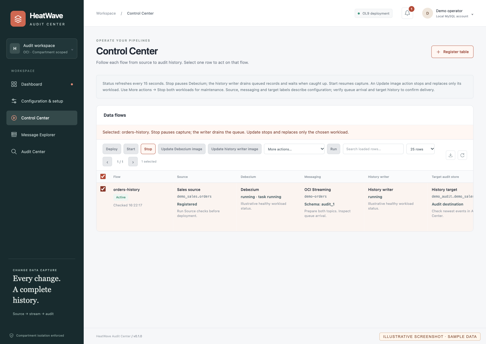

*Control Center with one selected flow and component status blocks. Illustrative screenshot using the current templates and isolated sample data.*


One row shows Flow, Source, Debezium, Messaging, History writer and Target audit store. Tick exactly one flow checkbox to enable its eligible actions. Multi-selection can help table exports but does not enable multi-flow lifecycle actions.

The Debezium block reports container/process and connector-task state, whether the deployed image differs from Workload settings defaults and a next-step tip. The writer block reports process state and a tip. Source, messaging and target labels describe configured endpoints; they are not delivery measurements. Status checks refresh approximately every 15 seconds while visible.

| State | Meaning / next action |
| --- | --- |
| Draft | Saved mapping; validate source, messaging, target and images before Deploy |
| Deploying / starting / stopping | OCI/process transition; refresh and inspect if persistent |
| Active | Fresh running process/task reports; still verify queue and target evidence |
| Pending | Incomplete deployment or unavailable task evidence; inspect missing workload/log access |
| Attention | Failed/exited process, stopped task or unexpected inactive workload; follow its tip |
| Capture paused | Debezium intentionally stopped; writer drains the queue and waits |
| Stopped | Both registered workloads inactive; Start resumes deployed images/checkpoints |
| Unavailable | Status cannot be established, including access/session errors; do not assume healthy |
| Retired | Capture retired; audit history preserved; termination/deletion are separate actions |

An inactive writer cannot consume. To select a fixed release, use Update history writer image rather than repeatedly starting an old failing image. A running connector task plus a running writer still requires target checkpoint and newest-event checks.

### Latest error belongs to the process

Each process block shows a compact latest-error summary and report time alongside state/exit code. Click the process field to open its full value, including the failed step and recovery guidance. For example, target-connect MySQL 2003 means the configured database is unreachable; verify DB availability before resuming the writer. Current images emit structured diagnostics. Older images may have logged only a database exception class; the app does not invent a missing numeric code. Log access can also be unavailable. A timestamped latest error can be historical after recovery.

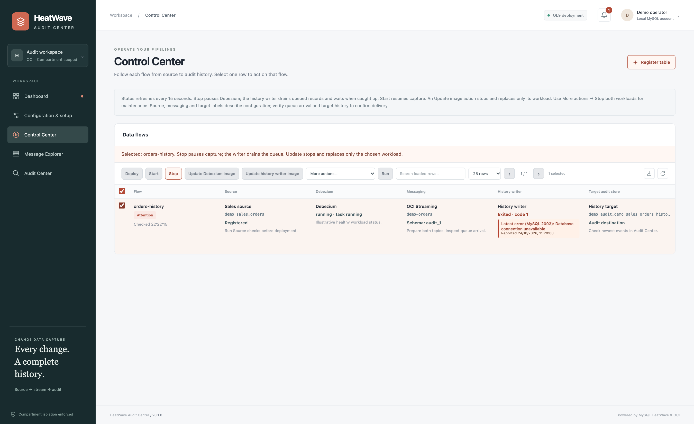

*Illustrative failed-writer example: MySQL code and report time; click the field for the failed step and next action. No live credentials or row images are shown.*

<a id="control-actions"></a>

## 28. Control Center: action conditions

All lifecycle actions require an administrator, exactly one selected flow and fresh supported state. The backend repeats readiness, scope, ownership and flow-lock checks.

| Action | Available condition and effect |
| --- | --- |
| Deploy | Non-retired flow missing one/both registered workloads; checks readiness and creates missing components |
| Start / Resume | Both components registered, supported ACTIVE/INACTIVE states, at least one inactive; resumes saved images/checkpoints |
| Stop | Debezium instance ACTIVE; pauses only capture while writer continues draining and waits |
| Stop both workloads | At least one workload ACTIVE; explicit maintenance stop of both components |
| Update Debezium image | Deployed Debezium ACTIVE/INACTIVE; open the release picker, select a different published release, then preflight, stop, wait and replace Debezium only |
| Update history writer image | Deployed writer ACTIVE/INACTIVE; open the release picker and select a different published release; replace writer only; capture may keep adding messages |
| Restart | Both components registered with supported ACTIVE/INACTIVE states; restart with existing state, no new position |
| Source checks / Capture start / Audit partitions | Open the selected flow's corresponding page; that page independently validates actions |
| Prepare schema topic | Non-retired flow with a queue registration; prepare required schema stream/topic |
| Refresh status | Request current health; does not reset offsets |
| Retire | Non-retired flow with registered workloads; stops capture/apply and preserves evidence |
| Terminate retired containers | Retired flow still has registered containers; terminate guarded resources |
| Delete mapping | Retired flow with no registered containers; remove the registration, retaining target evidence |

For More actions, select the action and click **Run**. A disabled Run means no eligible single flow/action is selected. Some actions require a confirmation describing their effect. The Update buttons open a release picker for running or stopped workloads. Choose a different available completed component release and submit; the action performs the required stop itself.

If shutdown exceeds the bounded wait, allow OCI to reach INACTIVE, reopen Update image and choose the intended release again. The app refuses to create a duplicate active replacement before confirming shutdown. A failed replacement can leave the old instance stopped; inspect the message and retry after correction.

Stopping capture while the source keeps changing consumes the source binlog-retention window. Stopping the writer consumes queue-retention capacity. Plan either pause against measured lag and retention, not container status alone.

### Choose the exact image for this flow

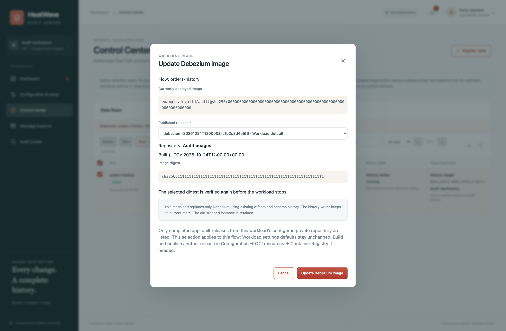

*Illustrative image-update dialog showing the deployed digest and the exact selected release.*

| Field / action | Meaning and condition |
| --- | --- |
| Currently deployed image | Digest-pinned image read from the registered Container Instance |
| Published release | Required dropdown of completed app-built releases for this component in its configured private repository and VM compartment/region; deleted, missing and current images are excluded |
| Repository / Built (UTC) / Image digest | Details of the chosen release; a Workload default label identifies the saved initial-deployment default |
| Update image | Enabled after choosing a different release; validates live availability/digest and supported state before stopping the selected workload |
| Cancel / × | Close without submitting an update |

The release ID and the instance shown in the dialog are checked again under the flow lock. A stale dialog is rejected if another update has replaced that instance. The selection is local to this flow and does not overwrite Workload settings defaults. An earlier published release can be chosen after compatibility review; rolling back an image does not reverse schema changes or source transactions.

**Workload default differs** means the deployed digest differs from the saved default; it is not a claim that the default is newer or that an update is mandatory. The old stopped instance remains for investigation or explicit removal after replacement health and checkpoint progress are verified.


<a id="capture"></a>

## 29. Choose where Debezium begins reading

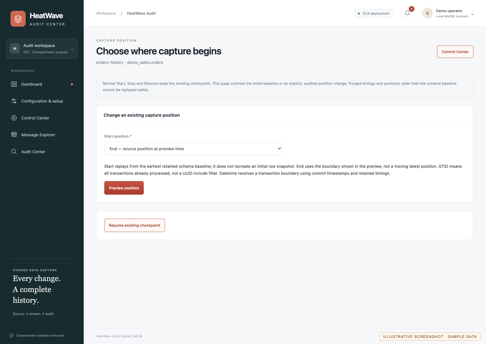

*Capture start choices for an existing flow. Illustrative screenshot using the current templates and isolated sample data.*


Open **Control Center → select one flow → More actions → Capture start → Run**. A new mapping's initial Start/End is also set during registration or an allowed draft Edit.

| Choice | New flow | Existing compatible flow |
| --- | --- | --- |
| Start | Snapshot current rows, then stream changes | Replay after earliest retained schema baseline, without recreating the initial row snapshot |
| End | Schema-only baseline, then future changes | Boundary fixed at preview time, subject to confirmed schema coverage |
| Specific GTID | Unavailable until schema history exists | Supply the complete executed GTID set; read transactions after it |
| Datetime | Unavailable until schema history exists | Resolve UTC time to first retained transaction at/after its commit timestamp |

**Preview position** checks retained binlogs, executed/purged GTIDs and schema evidence, then shows the resolved source offset. It does not move the connector. A compatible capture-control image is required. The preview is actor/flow-bound and expires after five minutes.

The supplied GTID set means already processed transactions, not a UUID include filter or instruction to include its final transaction. Non-cumulative holes and unsupported tagged sets are rejected. A source clock change can make timestamps non-monotonic; datetime is a boundary lookup, not a later per-event timestamp filter.

For an existing lagging connector, End/forward positioning can be rejected if it would skip uncaptured schema changes. Resume its checkpoint, let it catch up and preview again. Purged logs and positions older than the schema baseline cannot be replayed safely.

Normal Start, Resume and Restart retain the saved position; they do not reapply this choice on every launch.

<a id="capture-apply"></a>

## 30. Apply a reviewed capture position

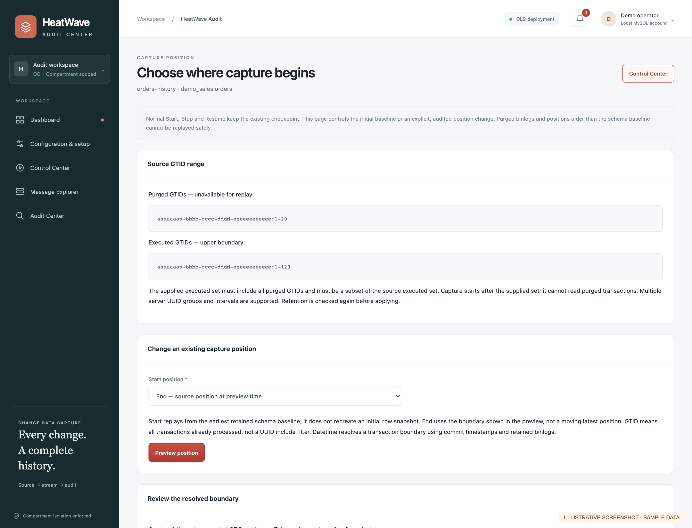

*Resolved boundary and explicit one-time apply acknowledgement. Illustrative screenshot using the current templates and isolated sample data.*


Review the binlog file, position and GTID set together with the earliest schema baseline. Moving backward can replay messages; moving forward can skip uncaptured changes. Existing history and writer checkpoints are retained, so this is not a target reset.

1. Generate a fresh Preview position on the intended flow.
2. Check its source identity, UTC boundary, retained-history coverage and operational reason.
3. Tick the acknowledgement only after reviewing replay/skip effects.
4. Choose **Apply this position once**. The source/schema checks run again.
5. Refresh the page and review Latest position request until its result is known. Verify the connector task, queue and target after it resumes.

The runtime stops the connector task through loopback Kafka Connect REST, saves its prior offset, patches/read-checks the reviewed offset and resumes. The OCI Container Instance itself remains running. Applied requests are not reapplied on a normal restart.

An ambiguous/failed request can leave the task stopped for review. **Resume existing checkpoint** resumes the currently stored offset without requesting a different boundary; it does not promise the previous pre-request position. Do not repeatedly apply a new reset to resolve an unrelated writer/permission failure.

A retired flow cannot change its position. Old images without the supported capture-control protocol cannot accept historical-position requests. Follow [capture positioning](../../capture-start.md) for detailed recovery semantics.

<a id="messages"></a>

## 31. Message Explorer

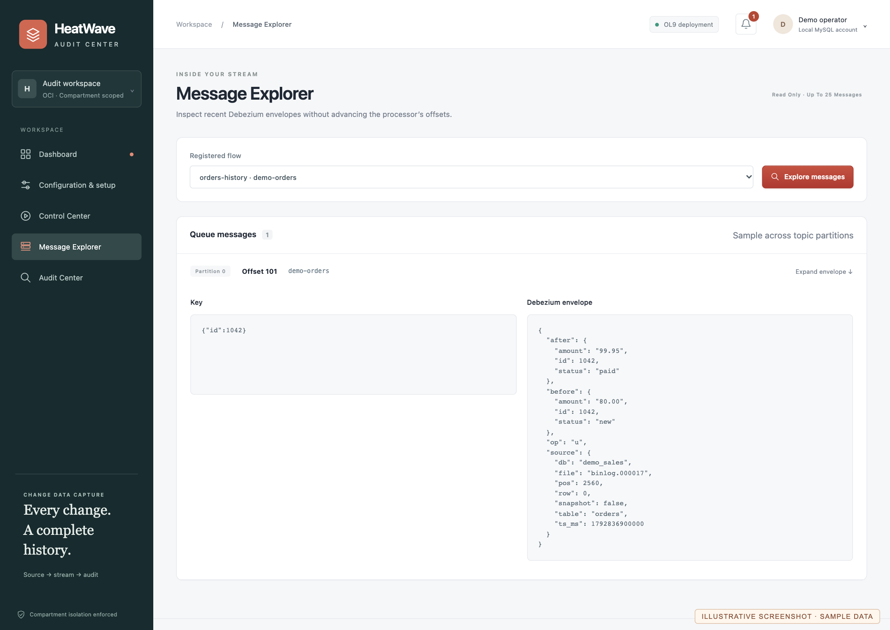

*Read-only sample with an expanded Debezium envelope. Illustrative screenshot using the current templates and isolated sample data.*


Choose **Registered flow**, then **Explore messages**. The page reads a bounded recent sample of up to 25 messages across the data topic's partitions. It does not advance or commit the history writer's consumer offsets.

| Display | What it establishes |
| --- | --- |
| Partition / Offset / Topic | Queue delivery coordinates for this sample |
| Key | Complete row key serialized by the producer; null is meaningful for some non-row records |
| Debezium envelope | Operation, before/after payload and source coordinates; expand the message row to inspect it |

Use the page to establish whether the data topic contains a recent event for a controlled source change. An empty sample does not prove the entire queue is empty or that no earlier retained events exist. Sampling is not a full message search, lag dashboard or replay action.

For DML, Debezium uses `c` (create), `u` (update), `d` (delete) and `r` (snapshot read). The target translates these to CREATE, UPDATE, DELETE and SNAPSHOT. Delete tombstones with null value are transport records, not a second business-row deletion.

This screen samples row data. Public schema events are archived separately and do not become ordinary row-image history entries. If the queue has the event but Audit Center does not, inspect writer health, target access, schema decoding, target checkpoint and any retention/conflict error. Do not move the source capture position to mask a downstream failure.

<a id="audit-overview"></a>

## 32. Audit Center: all databases overview

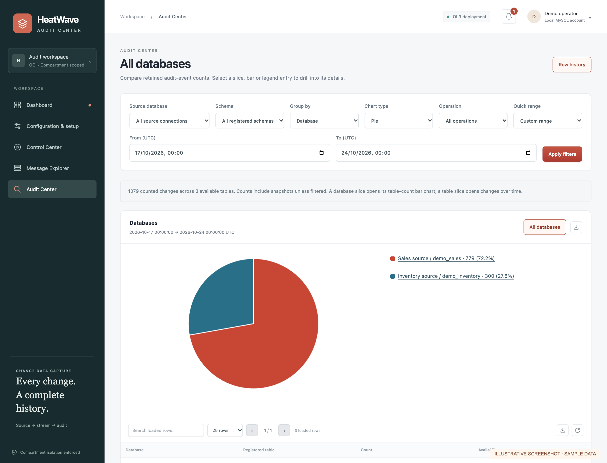

*All databases pie chart and table availability. Illustrative screenshot using the current templates and isolated sample data.*


Audit Center opens at the global overview. It counts retained target audit events across registered tables, not current business-row counts. Global views are limited to 100 tables with a 15-second counting budget; narrow the source selection for larger estates.

| Field / action | Purpose |
| --- | --- |
| Source database | All source connections or one registered source |
| Schema | All registered schemas or one selected schema |
| Group by | Database or registered table |
| Chart type | Pie or bar for the global count comparison |
| Operation | All or one operation; snapshots count unless excluded |
| Quick range / From / To (UTC) | Preset or custom retained time window |
| Apply filters | Recount the requested view within bounded query budgets |
| Chart slice / legend link | Database → its table bars; table → its changes-over-time view |
| All databases | Return to the broad grouping |
| Download chart PNG icon | Export the displayed chart image |

The companion table shows database, registered table, count and availability. An unavailable or unprepared table is excluded rather than counted as zero. If the notice reports exclusions or a count-budget limit, the displayed total is incomplete.

Use the same range/operation when comparing overview and drill-down counts. Count changes can reflect additional delivered events, retained-history expiry or changed filters. Snapshot initialization of one million rows can contribute one million SNAPSHOT records; it is not one summary event.

<a id="history"></a>

## 33. Audit Center: table history and lookup

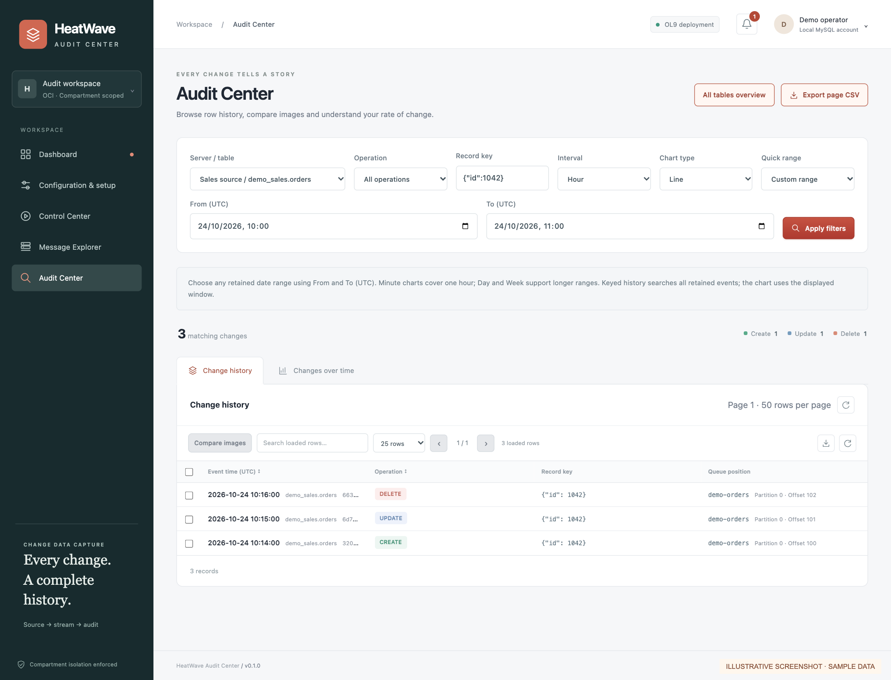

*Table-specific history with a typed record-key lookup. Illustrative screenshot using the current templates and isolated sample data.*


Choose a registered **Server / table**. Use **Change history** for individual events and **Changes over time** for charts. Tabs retain their selected view while applying filters.

| Field / control | Purpose / condition |
| --- | --- |
| Server / table | Select the exact flow/source table; histories are scoped by registration/source identity |
| Operation | CREATE, UPDATE, DELETE, SNAPSHOT or TRUNCATE; empty means all |
| Record key | Full primary-key JSON object with original JSON types, for example {"id":1042} |
| Interval / Chart type | Time chart grouping and line/bar/stacked-bar presentation |
| Quick range | Fill a common range; custom From/To remains available |
| From / To (UTC) | Explicit retained range; both supplied bounds are inclusive in history queries |
| Apply filters | Run the requested target query and refresh results |
| Export page CSV | Export the current loaded result page; not all retained history |
| Previous / Next | Server-side history pages of 50 events |
| All tables overview | Return to the global view |

Unkeyed browsing defaults to a bounded 24-hour window. Keyed lookup without an explicit start can search retained history for that key; the chart still uses its displayed chart window. Supply a sensible range for predictable query cost and comparable counts. Shared toolbar search/sort acts on loaded rows only.

Each row shows event time/identity, operation, record key and queue topic/partition/offset. Select exactly one row and choose **Compare images**. Click a field value for its full text. A key typo, wrong JSON type, wrong table/source or expired range can produce an empty result without implying capture failed.

<a id="images"></a>

## 34. Before/after images and operation meanings

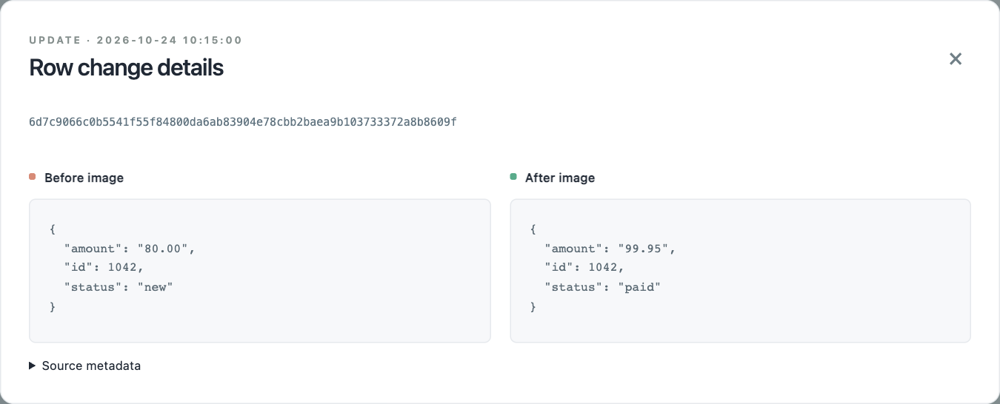

*Selected UPDATE showing its before and after images. Illustrative screenshot using the current templates and isolated sample data.*


| Operation | Meaning | BEFORE / AFTER |
| --- | --- | --- |
| CREATE | INSERT observed through the binlog | null / inserted row |
| UPDATE | Change to an existing source row | prior row / new row |
| DELETE | Source row removed | final row / null |
| SNAPSHOT | Existing row observed during initialization | null / current row at snapshot time |
| TRUNCATE | Table-level truncate evidence if delivered/supported | No reconstructed per-row deleted images |

The Row change details dialog includes event identity, formatted images and an expandable **Source metadata** section. Use source coordinates alongside queue position to investigate delivery/replay. **× / Escape** closes the dialog.

SNAPSHOT is not an original INSERT history. With initial Start, an existing million-row table can produce a million snapshot records; its earlier changes are not reconstructed. With a genuinely new End flow there is no existing-row snapshot, but schema metadata is still captured. Existing offsets take precedence on normal restarts.

Full update/delete images depend on what the source recorded. FULL row images and complete JSON settings must be correct before the relevant transaction is logged. Decimal, date/time, binary and other MySQL values follow the connector's converter representation; review the stored schema/source metadata rather than assuming every JSON string is a source VARCHAR.

The target retains a deleted row's earlier evidence until an explicit eligible retention cleanup removes payload history. Source deletion does not delete target history. Row images alone do not identify every actor or original SQL statement.

**DDL exception:** bulk partition/table operations can remove or exchange source rows without individual CREATE/DELETE images. An old event is the last observed row version, not proof that the row still exists. No DELETE event does not mean no deletion; see Appendix I.

<a id="charts"></a>

## 35. Charts, intervals and downloads

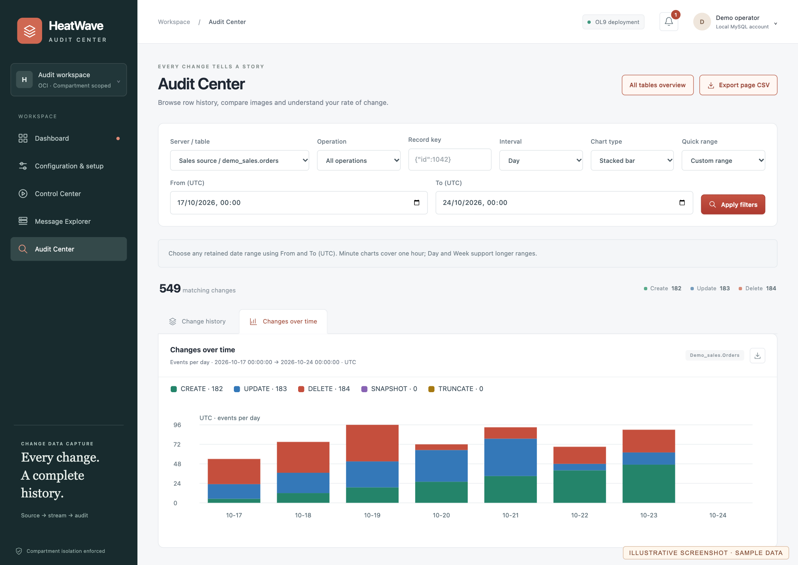

*Operation legend and custom-range stacked-bar chart. Illustrative screenshot using the current templates and isolated sample data.*


Use **Changes over time** after selecting a table. The operation legend explains the series; do not interpret two lines without their labels.

| Setting | Intended use |
| --- | --- |
| Minute (one-hour view) | Inspect minute buckets within one hour |
| Hour | Compare hourly activity in a bounded range |
| Day | Examine longer custom ranges by UTC day |
| Week (Monday UTC) | Aggregate longer periods into Monday-based UTC weeks |
| Line | Compare the direction and timing of operation rates/counts |
| Bar | Compare event counts per bucket |
| Stacked bar | Compare total volume and its operation composition |

The chart shows event counts per selected interval, not a guaranteed records-per-second capacity measurement. Change Interval and From/To together when expanding the range; the app bounds the chart to 1,000 buckets and query size. Minute mode is intentionally a one-hour view.

Use **Quick range** for last hour/24 hours/7 days/30 days/90 days, or enter custom UTC dates. **Apply filters** reruns the query. Empty buckets and no-data notices must be distinguished from unavailable target queries. Counts include SNAPSHOT unless the operation filter excludes it.

The chart download icon saves the displayed PNG. **Export page CSV** exports history rows on the loaded page. The global overview offers pie/bar comparisons and drill-down to this time view. Keep range, table and operation consistent when sharing screenshots or comparing charts.

DDL-driven row-set changes are not counted as individual DML unless row events were actually emitted. A large partition exchange/drop can have no row-volume spike. These charts measure captured audit events, not every source data change.

<a id="ddl-dcl"></a>

## 36. Schema changes and security auditing

### DDL: structural evidence

The public schema stream carries available CREATE/ALTER/DROP and snapshot schema observations. The writer stores `audit_schema_changes` separately from row payloads: prior definition, new definition, semantic delta, DDL text, source position and fidelity. A schema baseline records what was known at initialization; it is not proof that an earlier CREATE was captured.

For example, adding `region VARCHAR(16) DEFAULT 'EMEA'` and widening `amount DECIMAL(10,2)` to `DECIMAL(14,2)` can produce column-addition and precision-change differences. Compare properties actually present in the definitions. Defaults, indexes and partitioning can remain unknown/partial. An ALTER does not imply a new UPDATE audit event for every existing row.

There is no dedicated DDL comparison page in the current app. Use an authorized SQL client for schema evidence:

```sql
SELECT observed_at, object_name, change_kind, fidelity,
       before_definition, after_definition, semantic_delta
FROM demo_audit.audit_schema_changes
WHERE flow_id = 1 AND object_name = 'demo_sales.orders'
ORDER BY observed_at, event_id;
```

Replace the example schema/object/flow with the intended registration. Retain private Debezium recovery history independently; it is required to decode later events and is not a disposable presentation cache.

### DCL: user and privilege evidence

CREATE USER, GRANT and REVOKE are security/account-management operations. This prototype does not collect them as a complete security history or expose a DCL browser. Do not infer a privilege timeline by auditing changes to an incidental MySQL audit-configuration table.

An extension requires MySQL Enterprise Audit filters/user assignments and a separate collector that retains actor, account, privilege/scope, action, outcome and time. Oracle documents that audit logging is disabled by default until filters are configured. This collector, its target model and completeness validation remain future work. [MySQL Enterprise Audit guidance](https://docs.oracle.com/en-us/iaas/mysql-database/doc/mysql-enterprise-audit-plugin.html).

### DDL can change the row set without row images

EXCHANGE PARTITION can swap millions of rows without changing the column structure; DROP/TRUNCATE PARTITION can remove rows without individual DELETE images. ROW/FULL does not create the missing events. An empty semantic delta is not proof of unchanged data. The current schema writer requires matching decoded tableChanges entries and is not a raw-DDL catch-all. See Appendix I for coverage and mitigations.

<a id="daily-operations"></a>

## 37. Daily operations and a controlled verification

### Start-of-shift checks

1. Review Dashboard attention counts, then each affected Control Center process/task tip.
2. Confirm latest source-to-queue-to-target progress with a known event or authorized monitoring/checkpoint queries. Running status alone is insufficient.
3. Review source binlog age/storage, queue retention/lag and target partition runway/storage. Alerting/lag autoscaling is not provided automatically by this UI.
4. Review failed builds, safe OCI request IDs and operational notifications. Preserve diagnostic evidence before clearing messages.

### Authorized test-table example

Use a disposable registered test table, not an arbitrary production table. With initial End already established and healthy workloads:

```sql
INSERT INTO demo_sales.orders (id,status,amount)
VALUES (1042,'new',80.00);
UPDATE demo_sales.orders SET status='paid',amount=99.95
WHERE id=1042;
DELETE FROM demo_sales.orders WHERE id=1042;
```

In Message Explorer, look for row envelopes/coordinates. In Audit Center select the table and key `{"id":1042}` with the correct UTC range. Expect CREATE (after only), UPDATE (both images) and DELETE (before only). Compare values and target checkpoint progress. Reuse a key only if its previous history is understood.

For a planned pause, use Stop to pause capture while draining the queue. For target maintenance/cleanup use Stop both workloads and wait for INACTIVE. Resume within retention, then verify evidence and backlog recovery. Do not silently reset an expired queue offset or erase a conflicting record to make a process run.

Retiring a flow stops workloads and retains audit evidence. Terminate retired containers and delete the registration only after reviewing dependencies/recovery. OCI resource deletion is a separate guarded lifecycle operation.

<a id="summary"></a>

## 38. Summary and handover checklist

The application coordinates a registered table's journey from HeatWave binlog through Debezium and OCI messaging to retained audit evidence. Its useful result is a traceable before/after history that can be retrieved by typed row key and explored over time.

Before handing over an evaluation deployment, record:

- Its prototype status, intended evaluation scope and accepted capability limits.
- The app owner, OCI/database administrators, VM compartment, region and approved network access.
- Source/target registrations, dedicated Connect state, both public streams and image release/digest selections.
- The stable fingerprint-secret reference and the private state that must be preserved for recovery.
- Evidence of full-image capture, process/task health, target-before-ack behavior and row-key lookup.
- Tested source/queue outage windows, expected peak rates, target capacity and monitoring responsibilities.
- Explicit retention/hold decisions, backup/restore plans, cleanup approval ownership and rollback boundaries.

Keep real deployment inventories/runbooks under private, Git-ignored `internal_doc/`; the shareable guide uses examples only. Refer to the appendices for scaling, controlled configuration changes, updates and retention cleanup.

**This remains an independent prototype for evaluation and rehearsal, not an Oracle-supported product.** A successful demo or unit-test run does not establish production readiness, complete security auditing or a throughput/service guarantee.

<a id="scale"></a>

## Appendix A. Scaling and massive change volume

### What the current implementation can do

Each table flow has one Debezium connector and one history-writer container. Multiple source databases are separate registrations/flows. Connector `tasks.max=1` means adding Connect task count does not parallelize one MySQL binlog reader. More table flows can reread the same source binlog, increasing source/network/state overhead.

The writer preserves ordered lanes per assigned partition and uses bounded batches. Default `processor.batch` is 250 records, 4194304 bytes and 500 ms; offset commits are paced at 500 ms. The configured record limit is capped at 1000. Increase only from measured message size, target latency, memory and queue throttling. There is no promised throughput at these defaults.

### Find the bottleneck before changing capacity

| Evidence | Likely focus |
| --- | --- |
| Source commit ahead of Debezium position | Source/binlog extraction, connector CPU/memory/network and event size |
| Queue arrival ahead of target checkpoint | Writer capacity, target commit/index contention, throttling or poison/conflict records |
| Source and queue retention windows shrinking | Reduce pause/catch-up time; increase supported retention/capacity before expiry |
| Large JSON/BLOB/full-row envelopes | Message/byte budgets, supported queue size limits and target payload/storage cost |
| Hot row/key or one busy partition | Serial ordering lane; additional unrelated consumers cannot split that key's order |
| Slow broad charts/searches | Narrow key/time range, partition/index use and target query budget |

### Changes that need engineering, not just a button

Horizontal writer replicas can only add useful parallelism up to assigned data partitions and require stable group/partition ownership and target connection budgets. The app currently tracks one writer per flow; it has no replica-count control, lag-driven autoscaler or fleet reconciler. Do not launch unmanaged writers and assume lifecycle/cleanup checks cover them. Public schema consumption remains single-partition/serialized.

OCI Streaming does not support dynamic partition addition through Kafka compatibility. Plan partition count up front; moving to a new stream requires an explicit queue-incarnation, offset, lineage and replay migration. Shared multi-table source connectors, per-source dispatch, target sharding, cursor pagination and preaggregated chart statistics remain future work.

Capacity-test one peak-rate table first, then concurrent tables/sources, then failure/catch-up. Include binlog retention, queue limits, target commits/indexes, ledger growth, OCI quotas/cost and recovery evidence. Reconfirm current service limits using [OCI Streaming limits](https://docs.oracle.com/en-us/iaas/Content/Streaming/Concepts/streamingoverview_topic-Limits_on_Streaming_Resources.htm).

<a id="change"></a>

## Appendix B. Changing configuration safely

| Intended change | Supported route | Continuity consideration |
| --- | --- | --- |
| Rename a registration | Select one row → Edit | Keeps IDs, connector namespace, group and fingerprints |
| Change a draft mapping | Edit before deployment history | Revalidate live objects, queue and target compatibility |
| Change source/target endpoint of a deployed flow | New reviewed registration/migration | Name-only Edit protects existing identity; history adoption is not automatic |
| Choose a new binlog position | Capture start preview/apply | Requires retained schema/log coverage; can replay/skip changes |
| Select a new image | Select one flow → matching Update image action → release dropdown | Choice applies only to that flow; defaults and other flows stay unchanged |
| Change batch/TLS/runtime settings | Runtime settings revision plus controlled workload refresh | Existing instances retain their effective revision; test compatibility |
| Rotate database password | Coordinated Vault value rotation and workload refresh | Keep the supported secret reference; avoid source/writer login outages |
| Rotate row-fingerprint key | Not implemented for existing history | Preserve both key value and reference; changing value breaks lookup continuity |
| Change stream/pool/incarnation | Explicit migration/recovery plan | Never silently adopt new offsets or reset expired positions |
| Enable payload expiry | Per-flow retention policy plus stopped-flow cleanup | Durable cutoff persists; metadata/identity state is retained |

Back up the current configuration and recovery state before changes. Record the intended scope, operator, old/new revision and validation. Keep region/compartment fixed. When the UI locks a field, do not bypass it with direct repository edits; the lock preserves identities and checkpoints.

For a runtime change without an image change, review the actual replacement path first. The current Update submission requires a release different from the deployed image; saving JSON alone is not a generic rollout controller. Build/select a reviewed release when needed to produce a controlled replacement carrying the new effective settings.

After a change, check process/task health, queue arrivals, target checkpoint and a known row-history query. A green configuration-save message confirms the save, not successful deployment or data delivery.

<a id="update"></a>

## Appendix C. Update the application and workloads

### Web control-plane update on OL9

1. Back up the embedded repository, private configuration/runtime selection, installation identity, TLS material and relevant target recovery evidence. Coordinate a maintenance window and confirm no image build is active.
2. Verify the checkout remote/branch and clean working tree. Review the intended commit and dependency/schema changes before obtaining it. Never overwrite private state to make the tree clean.
3. Fetch the approved change, then update with a fast-forward pull when appropriate. Review differences before running setup.

```bash
git remote -v
git status --short
git fetch origin
git log --oneline HEAD..origin/main
git pull --ff-only origin main
./setup.sh
```

Setup reuses saved runtime defaults, validates units/dependencies and restarts the web service; it can interrupt web sessions. It does not reset an existing administrator or upgrade embedded MySQL across major versions. An Admin auto-update screen is not implemented in this application.

### Debezium/history-writer update

Build and publish the changed component from the updated VM checkout. Select one flow in Control Center and use its matching Update image action. In the dialog choose the completed component release and review its build time, repository and digest before submitting. This selection applies only to that flow; it does not save a new global default. Preflight runs before stopping; replacement waits for confirmed INACTIVE, preserving supported identities/checkpoints. The other component retains its current state.

A writer update can grow the backlog while Debezium continues. A connector update pauses capture while source binlogs continue. Ensure retention covers the interruption. If shutdown takes too long, wait, reopen Update image and choose the intended release again; do not create a parallel unmanaged instance.

Prepare required target layouts using the reviewed application path or `.venv/bin/python scripts/prepare_targets.py --flow-id <id>`. Incompatible existing payload tables are refused rather than silently migrated. Review schema-history reconciliation and protocol compatibility before replaying old evidence through new code.

Verify a controlled source event, target images and checkpoint progress after replacement. Rolling back an image is not a rollback of target DDL, a cleanup cutoff or source transactions; each needs its own recovery review.

<a id="cleanup"></a>

## Appendix D. One-action eligible payload cleanup

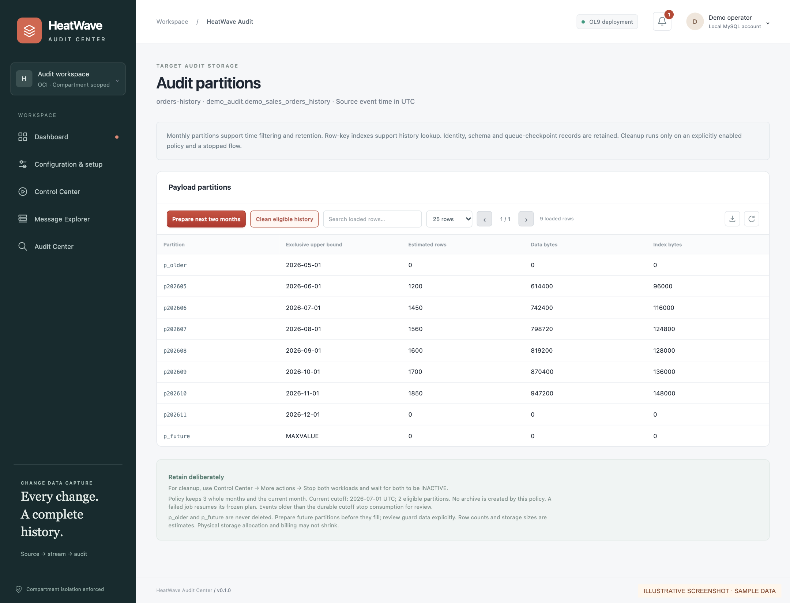

*Audit partitions with an explicit retention policy and eligible-history action. Illustrative screenshot using the current templates and isolated sample data.*


Cleanup is opt-in, per flow, destructive and deliberately scoped to eligible monthly payload partitions. It is not automatic deletion of all data or a full archive facility.

In Runtime settings, use the actual flow ID under top-level `retention`:

```json
{"retention":{"1":{"enabled":true,"retain_months":3,
 "archive_required":false,"legal_hold":false}}}
```

This example keeps three whole UTC calendar months plus the current month. Both archive and hold decisions must be explicitly false. A legal hold or archive-required policy blocks cleanup; verified archive export/restore is not implemented.

1. Review the retention/hold decision and any required external preservation. Save the policy.
2. In Control Center use **More actions → Stop both workloads** and wait for both instances to be INACTIVE. The backend independently checks this state and ownership.
3. Open **Audit partitions**. Review the cutoff, eligible partition list and estimates. **Prepare next two months** extends future runway; it does not expire old history.
4. Choose **Clean eligible history** and confirm the irreversible deletion. One action runs the bounded job and records durable progress. A failed job resumes its frozen plan rather than widening the cutoff on retry.
5. Check Cleanup jobs and remaining partitions. Restart only after reviewing the cutoff and any late/replayed events.

The action retains `p_older`, `p_future`, identity ledger, schema state, delivery checkpoints, retention state and job manifests. It drops only eligible named monthly partitions, with a maximum of 24 per job. Guard data needs separate investigation. The durable cutoff stops ingestion of older events for review, preventing expired payload from silently returning through replay.

The ledger and metadata continue growing. Their deletion needs a validated replay-floor/archive policy and is not coupled to this button. Physical storage allocation or billing may not shrink after dropping partitions.

Source partition DDL and target housekeeping are different. This target cleanup intentionally expires audit payloads and records cleanup/cutoff state; it does not generate one DELETE audit event per expired payload and is not an archive.

<a id="storage"></a>

## Appendix E. Target data layout and retrieval

The target schema contains the per-flow row payload table plus shared evidence/recovery tables. These are distinct from the embedded control repository.

| Store | Purpose / retained evidence |
| --- | --- |
| Selected payload audit table | event_time/event_id, flow/source/table, operation, complete key, key hash, images and fingerprints, source metadata, schema document, queue coordinates |
| audit_event_dedup | Unique event identity and payload fingerprint; protects supported replay across partition boundaries |
| audit_schema_changes | Public DDL/schema evidence: before/after definitions, semantic delta, source position, fidelity |
| Per-flow private JDBC schema-history table | Debezium recovery/decode state for OCI Streaming |
| audit_delivery_checkpoints | Durable target next offsets by delivery partition/incarnation |
| audit_capture_requests | Reviewed capture-position requests and execution evidence |
| audit_retention_state | Monotonic payload expiry cutoff and target identity |
| audit_cleanup_jobs / manifests | Frozen cleanup plan and durable progress |

New row payload tables use monthly RANGE COLUMNS(event_time) partitions, primary key `(event_time,event_id)` and a row-key history index. The unpartitioned identity ledger provides cross-partition identity uniqueness. Guard partitions contain older/out-of-runway events and are not ordinary expiry candidates. Existing unpartitioned/incompatible tables require an explicit migration.

The browser receives a typed key, computes the same HMAC as the writer and queries the row-key/time index. Event time supports partition pruning; a bounded range reduces work. Sorting/paging loaded rows is different from server query planning. Large broad searches and global count aggregation remain bounded and are not preaggregated analytics.

The target is audit evidence, not a current-row replica: a DELETE has a retained before image, a SNAPSHOT is an observation and a DDL event belongs to structural history. Schema fidelity may be partial, and cross-topic arrival order does not establish one global transaction order across tables/databases.

Use [before/after capture and retrieval](../../before-after-capture.md) for field-level detail and [design validation](../../design-validation.md) for checkpoints, partition and migration contracts.

<a id="troubleshoot"></a>

## Appendix F. Troubleshooting by observed stage

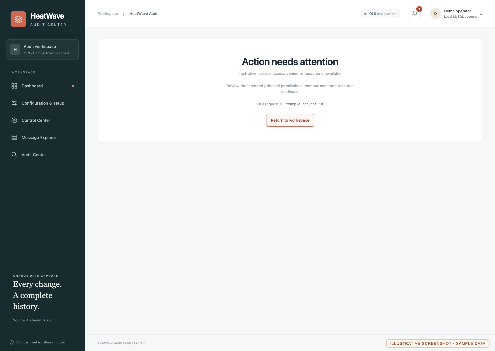

*Action needs attention with safe guidance and a request identifier. Illustrative screenshot using the current templates and isolated sample data.*


| Symptom | Inspect / next action |
| --- | --- |
| Connection test fails | Host/port reachability, database/account/grants, Vault reference/value, VM secret access and global TLS policy |
| Source checks require RELOAD/flush access | Dedicated account grants/roles; supported HeatWave FLUSH_TABLES alternative with LOCK TABLES |
| Fingerprint key missing | Runtime settings → Generate and configure key using permitted vault/key |
| OCI inventory 403/404 | Correct principal group/domain, service-specific permissions, compartment, region and resource readiness; retain request ID |
| Stream creation result ambiguous | Refresh/reconcile the pool/name/app provenance before retrying; never blindly duplicate |
| Deploy requests both topics | Prepare data and single-partition public schema stream; verify the selected harness/state |
| Debezium running, task unavailable | Fresh runtime/task health and log permissions, image compatibility, source/secret/network settings |
| Writer inactive or exited | Start existing healthy image, or select fixed release and Update writer; inspect target/checkpoint/decode errors |
| Queue has event, target has none | Writer state, target transaction/permissions, schema/type parsing, expiry cutoff or identity conflict |
| No source movement with End | New transactions after initialization, committed changes, correct table/database, retained binlog coverage |
| Image update disabled | Select exactly one non-retired flow whose relevant deployed instance is ACTIVE/INACTIVE; the dialog requires a different available component release |
| Capture-position request rejected | Binlog/schema baseline retained, executed set cumulative, compatible protocol, coverage not ahead of durable decoded history |
| Audit lookup empty | Correct source/table, complete typed key, UTC range and retained payload; verify source/queue/target stages |
| Cleanup unavailable/blocked | Enabled explicit policy, no hold/archive requirement, both workloads stopped, protocol/layout/ownership checks |
| HTTP 412 during DB lifecycle | Refresh lifecycle/precondition state; review safe service error/request ID before retry |

Use Notifications to retrieve recent messages; clearing them is not a remedy. The Action needs attention page gives the safe operation message, optional guidance/policy example and request ID. Use its return action to revisit the appropriate workspace.

Do not reset offsets, drop ledgers, replace the fingerprint key or delete evidence to force a successful status. A poison record/conflict stops consumption for investigation and is not silently skipped. Preserve the first error, effective image/config revision, flow identity, timing and relevant coordinates without copying passwords or row images into public tickets.

<a id="recovery"></a>

## Appendix G. Security, backup and recovery boundaries

### Security responsibilities

Use least-permitted same-compartment principals, private worker/DB paths, restricted web ingress and dedicated DB accounts. The default MySQL TLS mode encrypts without certificate verification; enable reviewed global verified trust when required. Authentication, CSRF, server-side sessions, scope and ownership checks protect app actions, but do not replace deployment security review.

Audit payloads can contain the full source row, including personal or sensitive values. Restrict access to target history, screenshots, exports, backups and logs. Redaction/column filtering and a complete field-level access model are not implemented. A history fingerprint is not encryption, anonymization or proof against all tampering.

### Preserve the state that defines continuity

Back up the embedded repository consistently, private deployment JSON, saved runtime selection, app installation identity and TLS material. Back up target payload/ledger/schema/checkpoint/capture/retention state together according to the chosen recovery objectives. Preserve the fingerprint secret and source identity. Retain required binlogs and queues; a backup does not make purged source/queue messages available again.

Use administrator-approved database/OCI backup tooling; the app has no one-click full backup/restore or verified archive facility. Keep backups private with appropriate encryption/access and test restoration on an isolated deployment. Do not publish them with this manual.

### Failure recovery rules

Normal Start/Resume uses durable checkpoints. The writer checks saved next offsets against queue watermarks and fails closed when history has expired or an offset is beyond queue end. Recreating a queue requires a new incarnation and reviewed recovery plan; silently seeking earliest/latest can lose evidence.

A replay can revalidate supported event identities; a mismatched payload for an existing identity is a conflict, not an overwrite. Snapshot observations differ from original DML. Source failover/server-identity changes, target restoration and connector lineage changes need explicit acceptance testing.

Do not claim a zero-loss recovery point or global transaction reconstruction until the actual chosen services, backups, retention and replay boundaries have been tested. Record any coverage gap as part of the audit evidence.

<a id="reference"></a>

## Appendix H. Glossary and further reading

| Term | Meaning in this manual |
| --- | --- |
| Flow | One registered source table, data topic and target payload table with its workloads |
| Binlog | Source MySQL binary log containing replication/change evidence |
| Debezium | Connector reading the source and producing change/schema events |
| Connect harness | OCI Streaming Connect configuration with isolated Connect state resources |
| History writer | Consumer that validates, fingerprints and writes target evidence |
| BEFORE / AFTER | Available row state immediately before/after the captured operation |
| GTID executed set | Transactions treated as already processed at the selected source boundary |
| Schema baseline | Earliest retained structural evidence from which this connector can decode safely |
| Fingerprint | Keyed row/content identity or non-secret event digest, depending on the field |
| Checkpoint | Durable next-delivery/source position used for restart/recovery |
| Incarnation / lineage | Identity separating messaging recreation and capture histories |
| DDL / DCL | Structural SQL / account and privilege administration |

### Repository guides

- [Setup and operations](../../operations.md)
- [IAM and database access](../../iam-policy.md)
- [Capture positioning](../../capture-start.md)
- [Before/after capture and retrieval](../../before-after-capture.md)
- [OCI resource provisioning](../../service-provisioning.md)
- [Design validation and remaining engineering work](../../design-validation.md)
- [Narrated demo and companion materials](../../../demo/index.html)

### Primary product documentation

- [Debezium MySQL connector 3.4](https://debezium.io/documentation/reference/3.4/connectors/mysql.html): connector behavior, snapshots and event representation.
- [OCI Streaming Kafka compatibility](https://docs.oracle.com/en-us/iaas/Content/Streaming/Tasks/kafkacompatibility.htm): API compatibility and service differences.
- [OCI Streaming limits](https://docs.oracle.com/en-us/iaas/Content/Streaming/Concepts/streamingoverview_topic-Limits_on_Streaming_Resources.htm): confirm current quotas and data-plane budgets.
- [MySQL Enterprise Audit on HeatWave](https://docs.oracle.com/en-us/iaas/mysql-database/doc/mysql-enterprise-audit-plugin.html): filters and security-audit source configuration.
- [OCI Container Instances permissions](https://docs.oracle.com/en-us/iaas/Content/container-instances/permissions/policy-reference.htm): workload resource-principal and management permissions.

This manual documents an independent prototype. Service limits, versions and permissions can change; review the linked primary documentation and validate the selected deployment when operating it.

<a id="ddl-data-limitations"></a>

## Appendix I. DDL-driven row changes and audit coverage

**This prototype cannot promise complete row history for DDL-driven data changes.** MySQL logs DDL as statements even in ROW mode. FULL supplies columns in row events; it does not create individual row images for a partition swap or drop. Debezium and the writer cannot recover missing values from a DDL statement.

| Operation | What can happen | Evidence limitation |
| --- | --- | --- |
| EXCHANGE PARTITION ... WITH TABLE | Swap a partition with an unpartitioned table | No individual CREATE/DELETE for the exchange, even if both objects are registered |
| DROP PARTITION | Usual INPLACE RANGE/LIST operation removes the partition and its data | No per-row DELETE/BEFORE records |
| TRUNCATE PARTITION | Empty chosen partitions without changing their definitions | No per-row deleted images; structural delta can be empty |
| TRUNCATE TABLE / DROP TABLE | Remove current table contents | A table-level/schema event is not a list of deleted-row images |
| Column changes / defaults | Alter existing logical values or discard a column | No guaranteed UPDATE for every existing row |

Exact effects depend on the supported MySQL version, engine and algorithm. DROP PARTITION with COPY can redistribute some rows rather than delete the entire old row set. REORGANIZE commonly preserves logical data while changing placement; physical movement is not automatically a logical UPDATE.

### Schema history is not a partition-row snapshot

The separate public schema path can archive supported matching tableChanges, including available structure/DDL/source positions. It does not retain every partition row. The current writer has no raw-DDL catch-all; parser/version/filter behavior or no matching tableChanges can leave no schema record. Validate each exact statement on a test flow.

EXCHANGE can change millions of visible rows while retaining the same structure. An empty semantic_delta therefore does not prove unchanged contents. Client affected-row counts and before/after structure definitions are not row-set comparisons.

### Effect on lookup, fingerprints and charts

A row removed through partition DDL can have an old CREATE/UPDATE and no later DELETE. A row brought in by exchange can have no CREATE. The most recent retained event is a last observation, not proof of current membership. Charts count captured events; a large DDL-driven change may not create a row-volume spike. HMAC fingerprints identify observed keys/values and do not prove capture completeness.

Restart, GTID repositioning, longer retention and ROW/FULL cannot synthesize absent events. A later snapshot is a new observation, not reconstruction of unavailable BEFORE values or intermediate changes. Do not label inferred differences as original Debezium DML.

### Mitigation policy; not automated here

1. Have the DBA review/limit data-impacting DDL on tables requiring complete row history. The prototype does not automatically block or flag every such operation.
2. Where feasible and approved, use ordinary logged DML with capacity/locking/retention review for removals or imports requiring individual row evidence.
3. For unavoidable DDL, preserve complete affected keys/rows and definitions before execution, including both sides of an exchange, at a coordinated source boundary.
4. Preserve the statement/outcome/coordinates and a consistent after-state. Control concurrent writes with a DBA-approved procedure; counts/checksums alone do not recover row values.
5. Retain separately derived reconciliation evidence and any coverage gap. Pre/post materialization, snapshot comparison and derived-event storage are not implemented features.

A separate audit log can identify a statement/actor/outcome but not every removed row. Preserved exchanged tables/backups may help recovery; a DDL-only log cannot restore values absent from all retained evidence.

Sources: [MySQL binary-log formats](https://dev.mysql.com/doc/refman/8.4/en/binary-log-setting.html), [partition exchange](https://dev.mysql.com/doc/refman/8.4/en/partitioning-management-exchange.html), [partition drop/algorithm semantics](https://dev.mysql.com/doc/refman/8.4/en/partitioning-management-range-list.html), [TRUNCATE TABLE](https://dev.mysql.com/doc/refman/8.4/en/truncate-table.html). See the [full limitations guide](../../limitations.md) for additional snapshot, retention, DCL, key and scaling boundaries.

<a id="heatwave-etag-errors"></a>

## Appendix J. HeatWave ETag issue and process errors

### What failed and what changed

DB-system Start returned HTTP 412 NoEtagMatch even after fetching a fresh resource ETag. Some compressed GET responses used an ETag ending in --gzip. An uncompressed GET removed that representation suffix, but a subsequent resource-version mismatch still occurred. Compression was not the only observed cause; refreshing was not a sufficient remedy.

**HeatWave OCI operations now omit ETag/If-Match.** Oracle documents the lifecycle header as optional. The app keeps VM instance-principal authentication, exact compartment checks, required lifecycle state, request IDs and per-operation idempotency tokens. Deletion still requires app ownership and unused dependencies. It does not strip a suffix from an opaque ETag or change IAM to work around 412.

The read and action are not an atomic version lock. A concurrent operation can change state and OCI can still reject a request. A remaining 412 needs the requested action, resource name, last checked state, active work request and request ID for investigation. It is not automatically a password or IAM problem.

### Why a writer can exit while its instance is ACTIVE

A stopped/unreachable target can cause MySQL 2003 during target connection or a lost-connection error during processing. OCI Container Instance lifecycle ACTIVE does not prove the application process is running. Debezium can independently retry a stopped source while its task still reports RUNNING.

Restore source/target DB availability, verify the configured connection and restart/resume the registered workload with existing checkpoints. Do not start every old INACTIVE instance; older stopped image versions can remain after replacements. Do not reset offsets, recreate streams or delete history to clear an attention badge.

### What the latest-error display means

Each process block retains state/exit status and displays a compact latest safe logged error with time and relevant MySQL code. Clicking the process field opens its full diagnostic, including the failed step and next action. Examples include target connect, envelope decode, target/schema commit, checkpoint save and queue acknowledgement. Known codes are mapped to fixed guidance; raw exceptions, SQL, passwords and row values are not exposed.

Current images produce structured diagnostics. Older images may contain only an exception class, and unavailable log access is not proof that no error occurred. The display reports only evidence actually present and can show a historical error after a process recovers. Current health, queue arrival and target checkpoint progress remain separate checks.

[OCI lifecycle and ETag notes](../../service-provisioning.md#heatwave-lifecycle-operations-and-etags) · [Oracle DB system SDK](https://docs.oracle.com/en-us/iaas/tools/python/latest/api/mysql/client/oci.mysql.DbSystemClient.html).

<a id="compartment-limits"></a>

## Appendix K. Same-compartment resource limitation


HeatWave Audit Center is an independent prototype for evaluation and rehearsal,
not an Oracle product. This installation supports **one VM compartment and the
VM region**. OCI management calls use the VM instance principal. Private runtime
configuration must match the compartment and region reported by the VM metadata
service; selecting another compartment or switching credentials is not a bypass.

This is an **application design restriction**. It is not a statement that OCI
services universally prohibit cross-compartment architectures. Shared resources
in another compartment are outside this prototype's supported deployment model,
even when an IAM policy could permit access.

## What must be in the VM compartment

| Resource or reference | Current application boundary |
| --- | --- |
| Administrator password secret | Select an ACTIVE secret from the VM compartment in Add connection; the app tests the selected credential before use |
| Dedicated Debezium/history-writer password secret | Created in the VM compartment; its username/reference replace the temporary administrator inputs |
| Vault and encryption key | Choose an ACTIVE Vault and enabled AES key in the VM compartment; the key must belong to the selected Vault |
| Existing credential secrets | Use a local-compartment secret and Vault; importing an out-of-compartment OCID is not a supported alternative to selection |
| Row-fingerprint secret | Dedicated, stable secret in the same compartment; preserve it for all existing history |
| OCI Streaming | Stream pool, data/schema streams and Connect configuration in the same compartment |
| Managed Apache Kafka | Cluster/configuration and referenced networking in the same compartment |
| Container Registry | Private repository and selected images in the same compartment |
| Container Instances | Workloads and their selected subnet/VCN attachments in the same compartment |
| Managed networking | Existing VCNs, subnets and referenced NSGs checked by the provisioning path must be in the VM compartment; shared networking is not modified |
| OCI-managed HeatWave DB resources | List/create/start/stop/delete paths are compartment constrained; deletion additionally requires app ownership and dependency checks |

The secret dropdown lists metadata and names, never plaintext secret values.
Empty lists or denied metadata access do not authorize selecting from a different
compartment. Restore the intended VM principal access or create the resource in
the VM compartment. Check which principal needs access: the VM manages/tests
resources, while containers independently resolve credentials and pull images
using their resource principals.

Selecting a compartment-local secret is not a relocation of its existing Vault.
When provisioning existing/shared resources manually, keep both the secret and
its Vault/key in the selected boundary. New account/fingerprint setup explicitly
checks the selected Vault/key attachments. The prototype does not implement a
cross-compartment credential-sharing or secret-migration workflow.

## Database addresses are a separate limitation

Connection registration accepts a database hostname/IP, port, database, username
and selected Vault reference. It tests actual MySQL connectivity/login over TLS.
It does not require a DB-system OCID or infer resource ownership from the address.
**A successful host-only connection test does not prove the database's OCI
compartment.** Operators must place the source/target DB systems in the intended
compartment and verify their placement independently. The OCI HeatWave resource
controls perform resource-ID compartment checks, but those checks do not turn an
unassociated host-only registration into an attested DB-system identity.

## Catalog and IAM distinctions

Shapes, service versions and Oracle-owned default configuration catalogs are
service-supplied choices, not resources created by this app in another customer
compartment. Selecting an Oracle default configuration omits a foreign custom
configuration reference. Tenancy-level IAM groups, dynamic groups and policies
must be prepared by an administrator; the application does not create or change
them.

## Troubleshooting and future scope

1. Confirm the VM compartment/region and configured principal before investigating
   an empty resource dropdown or OCI 403/404.
2. Confirm the resource is ACTIVE/available and located in that compartment.
   Credential lookup requires secret metadata and secret-bundle access; creation
   additionally needs permitted Vault/key operations.
3. Check the VM and worker principal permissions separately. Do not broaden access
   or switch to API-key credentials to avoid the application boundary.
4. Preserve fingerprints, offsets, checkpoints, identity tags and secret values
   during any planned migration. The app does not automatically move/adopt shared
   resources or rewrite existing audit history.

Supporting multiple resource compartments or regions would require an explicit
scope model, separately approved IAM/network access, attachment validation,
credential handling and migration/recovery tests. Editing an OCID in private JSON
alone is not that implementation.
